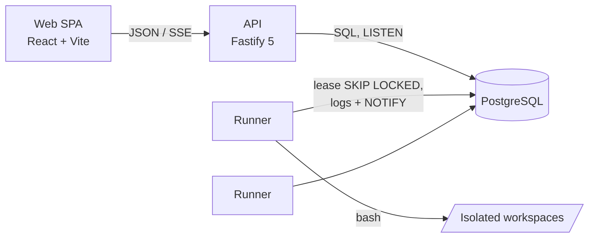

# Railyard

**Self-hosted CI/CD pipeline orchestrator.** Pipelines are YAML files with stages, jobs, a `needs`
DAG, matrices and conditions. Runner processes lease jobs straight from PostgreSQL, execute shell
steps in isolated workspaces and stream logs live to the browser. No containers, no hosted
services, no third-party APIs: Node.js, PostgreSQL and bash are all it needs.

[](https://github.com/mayur19/railyard/actions/workflows/ci.yml)


> **Status: foundation + first vertical slice (about 10% of the plan).** The pipeline engine,
> run creation, the runner and live logs work end to end. Everything else is designed,
> documented and tracked in the [backlog](docs/planning/backlog.md); planned API routes answer
> `501` with their ticket ID. See [implementation status](docs/planning/implementation-status.md).

## What works today

- **Pipeline engine** (`packages/shared`, ~250 unit tests): YAML with line/column error
  positions, a strict in-house schema validator, an expression language for `if:` and
  `${{ }}`, matrix expansion with `include`/`exclude`, cycle detection, topological levels,
  critical path, implicit stage dependencies and cascade exclusion, plus an in-house cron parser.
- **Runs**: `POST /api/projects/:id/runs` validates, plans and persists every job instance and
  step in a single transaction.
- **Runner**: leases with `FOR UPDATE SKIP LOCKED`, heartbeats its lease, reaps crashed runners'
  jobs, runs bash steps with timeouts and process-group termination, retries, and promotes
  dependents (`on_success`, `on_failure`, `always`, `allow-failure`).
- **Live logs**: sequenced chunks in Postgres, `LISTEN/NOTIFY`, Server-Sent Events with
  `Last-Event-ID` resume, ANSI colours in the browser, chunk-safe secret masker.
- **Auth and safety**: scrypt, Postgres sessions with HMAC'd ids, CSRF, RBAC, audit log, login
  throttling (per IP, per email with progressive backoff, per-IP email fan-out cap, IPv6 /64),
  explicit `TRUST_PROXY`.
- **Web UI**: run graph with live logs, pipeline editor with inline validation and plan preview.

```yaml
name: storefront-ci
stages: [build, test, deploy]
jobs:
  compile:
    stage: build
    steps:
      - run: echo "compiling at ${{ sha }}"
  unit:
    stage: test
    needs: [compile]
    matrix:
      node: [20, 22]
      shard: [1, 2]
      exclude: [{ node: 20, shard: 2 }]
    steps:
      - run: echo "node ${{ matrix.node }} shard ${{ matrix.shard }}"
  deploy:
    stage: deploy
    if: "branch == 'main'"
    steps:
      - run: echo deploying
  notify:
    stage: deploy
    needs: [unit]
    when: on_failure
    steps:
      - run: echo "tests failed on ${{ branch }}"
```

## Quick start

Requirements: Node.js 22+, npm, bash, PostgreSQL 15+ running locally (socket in `/tmp`, your OS
user, no password).

```bash
git clone https://github.com/mayur19/railyard.git && cd railyard
./run.sh            # deps, .env with random secrets, databases, migrations, demo data, then dev servers
```

Open http://localhost:5105 and sign in as `owner@railyard.local` / `railyard-demo-pass`
(development seed only; also `dev@railyard.local` and `viewer@railyard.local`).

| Command           | What it does                                                           |
| ----------------- | ---------------------------------------------------------------------- |
| `./run.sh setup`  | Prerequisites, `.env`, `railyard_dev` + `railyard_test`, migrate, seed |
| `./run.sh dev`    | API (:4105) + one runner + web (:5105) with reload                     |
| `./run.sh runner` | Start an additional runner process                                     |
| `./run.sh test`   | Unit + integration tests against `railyard_test`                       |
| `./run.sh check`  | Lint, format, typecheck, tests, build (same as CI)                     |
| `./run.sh reset`  | Drop, migrate and reseed the dev database                              |
| `./run.sh help`   | All commands                                                           |

## Architecture



A modular monolith in npm workspaces: `packages/shared` holds the pure domain (validator,
planner, cron, state machine, ANSI, masker), `apps/api` the HTTP API, migrations and the runner
process, `apps/web` the UI. See [architecture overview](docs/architecture/overview.md) and the
[ADRs](docs/adr/README.md).

## Documentation

Start at [docs/README.md](docs/README.md): PRD and requirements, architecture and ADRs, system
design and data model, OpenAPI spec, threat model, test strategy, runbook and deployment
(systemd + nginx), roadmap, backlog and risks.

## Contributing

See [CONTRIBUTING.md](CONTRIBUTING.md). Security reports: [SECURITY.md](SECURITY.md).

## License

[MIT](LICENSE) © Mayur Dusane
