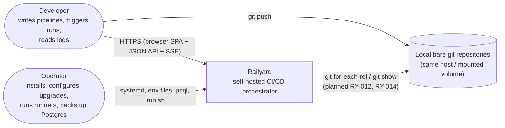
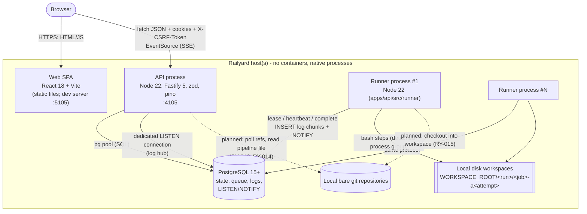
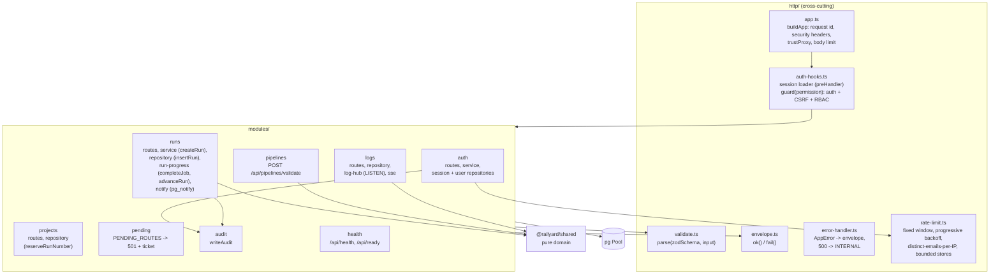
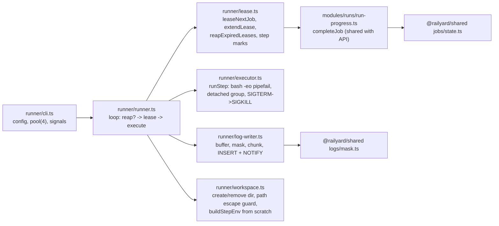

# Architecture overview

Railyard is a self-hosted CI/CD pipeline orchestrator. A pipeline is a YAML file (`.railyard.yml`) describing stages, jobs, matrices and shell steps; Railyard validates it, compiles it into an execution plan (a DAG of job instances), persists the plan as rows, and lets runner processes lease and execute the jobs while developers watch logs live in the browser.

This document describes the system at three C4 levels, the module boundaries that the code enforces, and the lifecycle of an HTTP request and of a pipeline run. Decisions referenced here are recorded in [../adr/README.md](../adr/README.md); the detailed algorithms and state machines are in [../design/system-design.md](../design/system-design.md); tables are in [../design/data-model.md](../design/data-model.md).

Status legend used throughout: **implemented** means merged on `main` with tests; **planned** means a backlog ticket in [../planning/backlog.md](../planning/backlog.md) exists and the code is absent or answers `501 NOT_IMPLEMENTED`.

---

## 1. System context (C4 level 1)

Railyard has no external service dependencies: no hosted git provider, no email provider, no object store, no container registry. Source code arrives through local bare git repositories on the same host (or a mounted filesystem); notifications go to a local outbox (planned, RY-131).



| Actor                                           | Goals                                                                                                            | Interface                                                                                          |
| ----------------------------------------------- | ---------------------------------------------------------------------------------------------------------------- | -------------------------------------------------------------------------------------------------- |
| Developer (roles `developer`, `admin`, `owner`) | Author and validate pipelines, trigger runs, follow live logs, inspect the run graph                             | Web SPA on port 5105 (dev) behind the same origin as the API; JSON API on port 4105                |
| Viewer (role `viewer`)                          | Read-only access to projects and runs                                                                            | Same as developer, read permissions only                                                           |
| Operator                                        | Install on a VM or bare metal, configure `.env`, run migrations, start API and runner services, back up Postgres | `run.sh`, `npm run db:migrate`, systemd units (planned RY-009), `pg_dump` (planned tooling RY-140) |

---

## 2. Containers (C4 level 2)



| Container                   | Technology                                               | Responsibility                                                                                                                   | Scaling today                                                                                                  | Status                                                                               |
| --------------------------- | -------------------------------------------------------- | -------------------------------------------------------------------------------------------------------------------------------- | -------------------------------------------------------------------------------------------------------------- | ------------------------------------------------------------------------------------ |
| Web SPA                     | React 18, Vite, TypeScript                               | Login, projects, pipeline editor with inline issues, run list, run graph (DAG columns by level), live ANSI log viewer over SSE   | Static files; any number of browsers                                                                           | Implemented slice (RY-120..RY-125)                                                   |
| API process                 | Node 22, Fastify 5, zod, pino, `pg`                      | Authentication, RBAC, validation and planning, run creation, run/log queries, SSE fan-out, pending-route registry                | **Exactly one process** until rate-limit counters move to Postgres (RY-151) and LISTEN failover lands (RY-144) | Implemented                                                                          |
| Runner process              | Node 22, same package as the API (`apps/api/src/runner`) | Register, lease a queued job, heartbeat, run bash steps in a workspace, stream logs, complete the job, reap expired leases       | Any number of processes on any number of hosts that can reach Postgres                                         | Implemented (direct DB access); remote HTTPS runners planned (RY-056)                |
| PostgreSQL 15+              | Native install                                           | System of record; job queue (`FOR UPDATE SKIP LOCKED`); log store; pub/sub via `LISTEN/NOTIFY`; migration lock via advisory lock | Single primary                                                                                                 | Implemented                                                                          |
| Local bare git repositories | `git` CLI                                                | Source of pipeline files and code                                                                                                | Filesystem                                                                                                     | Planned integration (RY-012..RY-017); today the YAML is submitted in the run request |
| Local disk workspaces       | Filesystem under `WORKSPACE_ROOT`                        | One empty directory per job attempt; removed after the attempt unless `RUNNER_KEEP_WORKSPACES=true`                              | Per runner host                                                                                                | Implemented; quotas planned (RY-057)                                                 |

Deliberately absent: Docker or any container runtime, message brokers (Redis, RabbitMQ, Kafka), object storage, external identity providers. See [ADR-0018](../adr/0018-no-docker-native-processes.md).

---

## 3. Components (C4 level 3)

### 3.1 API process



### 3.2 Runner process



### 3.3 Shared domain package (`packages/shared/src`)

| Module                                                   | Contents                                                                                                                                    | Depends on                            |
| -------------------------------------------------------- | ------------------------------------------------------------------------------------------------------------------------------------------- | ------------------------------------- |
| `pipeline/yaml.ts`                                       | `loadYaml`: parse with the `yaml` library (unique keys, alias cap 50, 256 KiB cap), keep a `LineCounter`, return a path-to-position locator | `yaml`                                |
| `pipeline/validate*.ts`, `issues.ts`, `limits.ts`        | Hand-written structural and semantic validator producing `PipelineIssue { severity, code, path, message, line?, column? }`                  | `cron`, `dag`, `expression`, `matrix` |
| `pipeline/expression.ts`, `interpolate.ts`, `context.ts` | Tokenizer, recursive-descent parser and evaluator for `if:` and `${{ }}`; reference scope checks                                            | none                                  |
| `pipeline/matrix.ts`                                     | Cartesian product, exclude, include merge/append, instance keys                                                                             | none                                  |
| `pipeline/dag.ts`                                        | `findCycle` (iterative 3-colour DFS), `topologicalLevels` (Kahn), `criticalPath`, `ancestors`                                               | none                                  |
| `pipeline/plan.ts`                                       | `compilePlan(spec, runContext) -> ExecutionPlan`                                                                                            | all of the above                      |
| `jobs/state.ts`                                          | Job/run status enums, transition table, `resolveBlockedJobs`, `deriveRunStatus`, `outcomeAfterAttempt`                                      | none                                  |
| `logs/mask.ts`, `logs/ansi.ts`                           | Streaming secret masker; ANSI SGR parser for the log viewer                                                                                 | none                                  |
| `cron/cron.ts`                                           | 5-field cron parser and `nextRun` (UTC)                                                                                                     | none                                  |
| `api/schemas.ts`                                         | zod request schemas, `ROLES`, `PERMISSIONS`, `ROLE_PERMISSIONS`, `hasPermission`, envelope types                                            | `zod`                                 |

---

## 4. Module boundaries

The boundaries below are enforced by package structure and imports; they are the main maintainability lever of the modular monolith ([ADR-0001](../adr/0001-modular-monolith-npm-workspaces.md)).

1. **`packages/shared` is pure.** No I/O, no `pg`, no `fs`, no `process.env`, no clock reads except where a `Date` is passed in (`nextRun(schedule, after)`). Every function is deterministic and returns new values (`resolveBlockedJobs` returns a list of changes instead of mutating its input). This is what lets the web app import the validator for instant feedback and lets the planner be property-tested.
2. **`apps/api/src/http` is cross-cutting only.** It knows about envelopes, errors, sessions and permissions but nothing about pipelines or runs.
3. **Each API module owns its tables.** `auth` owns `users`, `sessions`, `memberships`; `projects` owns `projects`; `runs` owns `pipeline_runs`, `jobs`, `job_steps`; `logs` owns `job_log_chunks`; `audit` owns `audit_logs`. Cross-module access goes through exported repository functions (`findJobInOrganization` is exported by `runs` and used by `logs`).
4. **Routes never contain SQL.** Routes parse input (zod), call a service or repository, wrap the result with `ok()`.
5. **The runner reuses API modules, not HTTP.** Runner code imports `modules/runs/run-progress.ts`, `modules/runs/notify.ts` and `modules/logs/log.repository.ts` directly and talks to Postgres. Remote runners (RY-056) will move the same calls behind an HTTPS long-polling API without changing `completeJob`.
6. **`pending` mirrors the target API.** `PENDING_ROUTES` registers every planned endpoint with its real permission guard and answers `501 NOT_IMPLEMENTED` with `details.ticket`, so clients, OpenAPI and tests see the complete surface from day one.
7. **Tenant scoping is in the repository layer.** Every tenant-owned table carries `organization_id`; every repository query used by a route filters by `principal.organizationId` (e.g. `reserveRunNumber(db, organizationId, projectId)`, `listRuns(db, organizationId, projectId, ...)`). There is no code path that loads a tenant row by id alone from a route.

---

## 5. Request lifecycle

```mermaid
sequenceDiagram
  autonumber
  participant B as Browser
  participant F as Fastify (app.ts)
  participant S as Session loader
  participant G as guard(permission)
  participant R as Route handler
  participant Z as parse(zod)
  participant Repo as Repository
  participant PG as PostgreSQL
  participant E as Error handler
  B->>F: POST /api/projects/:id/runs<br/>Cookie: ry_session, X-CSRF-Token, X-Request-Id?
  F->>F: genReqId: accept X-Request-Id if /^[A-Za-z0-9._-]{8,64}$/ else randomUUID()
  F->>F: onRequest: x-request-id, nosniff, DENY, no-referrer, no-store
  F->>F: bodyLimit 512 KiB, trustProxy from TRUST_PROXY
  F->>S: preHandler
  S->>PG: UPDATE sessions SET last_seen_at=now()<br/>WHERE id=HMAC(SESSION_SECRET, cookie) AND expires_at>now()
  PG-->>S: session row (user, org, csrfToken) or none
  S->>PG: load user + membership role in that org (disabled users rejected)
  S-->>F: request.principal
  F->>G: route preHandler
  G->>G: no principal -> 401 UNAUTHENTICATED
  G->>G: POST/PUT/PATCH/DELETE: header == session csrfToken else 403 CSRF_FAILED
  G->>G: hasPermission(role, 'run:create') else 403 FORBIDDEN
  G->>R: handler
  R->>Z: parse(params), parse(body)
  Z-->>R: typed input or 400 VALIDATION_FAILED {details:[{path,message}]}
  R->>Repo: createRun(pool, principal, projectId, input, request.id)
  Repo->>PG: BEGIN; UPDATE projects ... WHERE id=$1 AND organization_id=$2; INSERT ...; COMMIT
  Repo-->>R: RunDetail
  R-->>B: 201 {data, error:null}
  Note over R,E: any thrown AppError -> E -> {data:null, error:{code,message,details?}}<br/>429 adds Retry-After; unknown errors log with request id and return 500 INTERNAL
```

Key properties:

- **Request id** flows into every pino log line (`request.log`), the `x-request-id` response header, the SSE response header and `audit_logs.request_id`.
- **Authentication is loaded for every request, authorisation is per route.** Public routes (`/api/health`, `/api/ready`, `/api/auth/register`, `/api/auth/login`) simply do not attach `guard`.
- **CSRF** uses a per-session token stored in `sessions.csrf_token`, delivered in the readable `ry_csrf` cookie and echoed by the SPA in `X-CSRF-Token`. It applies to every mutating method, including `POST /api/pipelines/validate`, which has no side effects but is still a POST.
- **Envelope**: every JSON response is `{ data, error, meta? }`. Paginated lists put `nextCursor` and `limit` in `meta`. Logs put `lastSeq`, `jobStatus`, `complete` in `meta`.
- **Error mapping**: `AppError(status, code)` for domain errors (`PIPELINE_INVALID`, `EMPTY_PLAN` as 422; `NOT_FOUND`; `CONFLICT`; `RATE_LIMITED`); Fastify client errors map to `BAD_REQUEST` or `PAYLOAD_TOO_LARGE`; anything else is logged and returned as an opaque `INTERNAL`.

---

## 6. Run lifecycle

```mermaid
sequenceDiagram
  autonumber
  participant U as Developer (SPA)
  participant A as API
  participant PG as PostgreSQL
  participant H as Log hub (API, LISTEN)
  participant R as Runner
  participant W as Workspace / bash
  U->>A: POST /api/projects/:id/runs {yaml, branch, sha, event}
  A->>PG: BEGIN; reserve run number (row lock on project)
  A->>A: validatePipelineYaml -> compilePlan (pure)
  A->>PG: INSERT pipeline_runs; INSERT jobs via jsonb_to_recordset;<br/>INSERT job_steps via jsonb_to_recordset; INSERT audit_logs;<br/>pg_notify(railyard_jobs); COMMIT
  A-->>U: 201 run detail (jobs blocked/queued)
  U->>A: GET /api/runs/:id/jobs/:jobId/logs/stream (EventSource)
  A->>H: subscribe(jobId)
  loop poll every RUNNER_POLL_MS when idle
    R->>PG: BEGIN; SELECT ... FOR UPDATE SKIP LOCKED LIMIT 1;<br/>UPDATE job running, attempt+1, lease; run -> running; NOTIFY; COMMIT
  end
  R->>W: create workspace, bash -eo pipefail per step
  par every lease/3 seconds
    R->>PG: extendLease (owner check)
  and output
    W-->>R: stdout/stderr
    R->>R: mask -> buffer (250 ms / 64 KiB)
    R->>PG: INSERT job_log_chunks (seq...), pg_notify(railyard_logs)
    PG-->>H: notification {jobId, seq}
    H-->>A: dispatch to SSE stream
    A->>PG: SELECT chunks WHERE seq > lastSeq
    A-->>U: event: log, id: seq
  end
  R->>PG: completeJob: lock run row, verify lease, settle or requeue,<br/>resolveBlockedJobs, deriveRunStatus, NOTIFY, COMMIT
  PG-->>H: railyard_jobs {jobId, status}
  A-->>U: event: status, then event: end when terminal
  Note over R,PG: if the runner dies, the reaper (any runner, every 10 s)<br/>completes expired leases as failed and the retry policy applies
```

The same steps are drawn per component, with failure paths, in [system-design.md section 3](../design/system-design.md#3-sequence-diagrams).

---

## 7. Deployment topology (summary)

- Single VM or bare-metal host: native PostgreSQL, one API process (systemd), one or more runner processes (systemd template unit, planned RY-009), nginx terminating TLS and serving the SPA build, proxying `/api` to `127.0.0.1:4105` with `proxy_buffering off` for SSE (`X-Accel-Buffering: no` is also sent by the API). `TRUST_PROXY=1` in that topology.
- Additional runner hosts only need network access to Postgres and a writable `WORKSPACE_ROOT`.
- Full procedures live in `docs/operations/deployment.md` and `docs/operations/runbook.md`.
