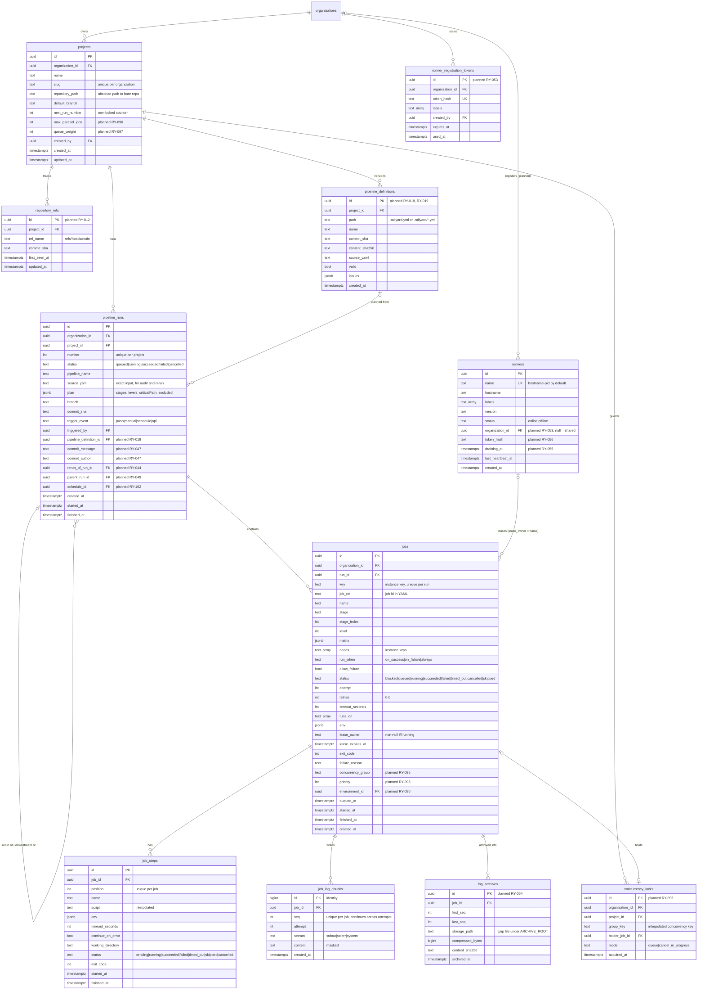

# Data model

The complete target schema for Railyard in PostgreSQL 15+, the notes and indexes for each table, and an exact account of which migrations exist today and which are planned (with the backlog tickets that will add them).

Conventions:

- Primary keys are `uuid DEFAULT gen_random_uuid()` except append-only, high-volume tables (`audit_logs`, `job_log_chunks`), which use `bigint` identity columns.
- Every tenant-owned table carries `organization_id` (directly, or through an owning row that carries it, as for `job_steps` and `job_log_chunks` via `jobs`). Repository queries reachable from routes always filter on it.
- Timestamps are `timestamptz`; lease and scheduling arithmetic uses the database clock (`clock_timestamp()`).
- Status columns are `text` with CHECK constraints rather than Postgres enums, so adding a status is a plain forward migration ([ADR-0015](../adr/0015-forward-only-sql-migrations-with-checksums.md)).
- Secrets and tokens are never stored in plaintext: session ids and API tokens as HMAC-SHA256 or SHA-256 digests, secret values as AES-256-GCM ciphertext.

---

## 1. Migration status

### 1.1 Existing migrations

| File                                              | Tables                                                                        | Tickets                        |
| ------------------------------------------------- | ----------------------------------------------------------------------------- | ------------------------------ |
| `apps/api/migrations/0001_foundation.sql`         | `organizations`, `users`, `memberships`, `sessions`, `audit_logs`             | RY-003, RY-020, RY-022, RY-023 |
| `apps/api/migrations/0002_projects_runs_jobs.sql` | `projects`, `pipeline_runs`, `jobs`, `job_steps`, `job_log_chunks`, `runners` | RY-010, RY-040, RY-050, RY-060 |
| (created by the migrator)                         | `schema_migrations`                                                           | RY-003                         |

### 1.2 Planned migrations

Numbers show the intended order by milestone; a number is fixed only when the migration is merged. Each migration is forward-only and runs in one transaction.

| Planned file                        | Adds                                                                                 | Alters                                                                                                            | Tickets                                                        | Milestone |
| ----------------------------------- | ------------------------------------------------------------------------------------ | ----------------------------------------------------------------------------------------------------------------- | -------------------------------------------------------------- | --------- |
| `0003_repositories_definitions.sql` | `repository_refs`, `pipeline_definitions`                                            | `pipeline_runs` + `pipeline_definition_id`, `commit_message`, `commit_author`, `rerun_of_run_id`, `parent_run_id` | RY-012, RY-014, RY-016, RY-018, RY-019, RY-044, RY-047, RY-049 | M2-M3     |
| `0004_runner_registration.sql`      | `runner_registration_tokens`                                                         | `runners` + `organization_id`, `token_hash`, `draining_at`                                                        | RY-053, RY-055, RY-056                                         | M4        |
| `0005_concurrency_scheduling.sql`   | `concurrency_locks`                                                                  | `jobs` + `concurrency_group`, `priority`; `projects` + `max_parallel_jobs`, `queue_weight`                        | RY-095, RY-096, RY-097, RY-098                                 | M4        |
| `0006_secrets.sql`                  | `encryption_keys`, `secrets`, `secret_versions`                                      | -                                                                                                                 | RY-070, RY-071, RY-073, RY-074                                 | M5        |
| `0007_artifacts_caches.sql`         | `artifact_blobs`, `artifacts`, `caches`                                              | -                                                                                                                 | RY-080, RY-082, RY-083, RY-084, RY-085, RY-086                 | M5        |
| `0008_log_archives.sql`             | `log_archives`                                                                       | -                                                                                                                 | RY-064, RY-143                                                 | M5        |
| `0009_identity_outbox.sql`          | `invitations`, `user_tokens`, `api_tokens`, `outbox_messages`, `rate_limit_counters` | `users` + `email_verified_at`                                                                                     | RY-024, RY-027, RY-028, RY-150, RY-151                         | M6        |
| `0010_environments_approvals.sql`   | `environments`, `deployments`, `approvals`, `approval_decisions`                     | `jobs` + `environment_id`; job status domain + `waiting`                                                          | RY-090, RY-091, RY-092, RY-093                                 | M6        |
| `0011_schedules.sql`                | `schedules`, `schedule_triggers`                                                     | `pipeline_runs` + `schedule_id`                                                                                   | RY-101, RY-102, RY-103, RY-104                                 | M7        |
| `0012_notifications.sql`            | `notifications`                                                                      | -                                                                                                                 | RY-130, RY-131, RY-132, RY-133                                 | M7        |
| `0013_metrics_rollups.sql`          | `job_metrics_daily`, `queue_metrics_hourly`                                          | -                                                                                                                 | RY-110, RY-113, RY-115                                         | M7        |

---

## 2. Target ERD

The diagram is split by domain for legibility. Entities appear with attributes once; when they reappear in another diagram they are relationship endpoints only. Tables marked `(planned)` in their comment do not exist yet.

### 2.1 Tenancy, identity and access

```mermaid
erDiagram
  organizations ||--o{ memberships : has
  users ||--o{ memberships : holds
  users ||--o{ sessions : opens
  organizations ||--o{ sessions : scopes
  organizations ||--o{ audit_logs : records
  users |o--o{ audit_logs : acts
  organizations ||--o{ invitations : issues
  users ||--o{ user_tokens : receives
  users ||--o{ api_tokens : owns
  organizations ||--o{ api_tokens : scopes
  organizations |o--o{ outbox_messages : sends

  organizations {
    uuid id PK
    text name "2-100 chars"
    text slug UK "lowercase, 3-50"
    timestamptz created_at
    timestamptz updated_at
  }
  users {
    uuid id PK
    text email "unique on lower(email)"
    text name
    text password_hash "scrypt$N$r$p$salt$hash"
    timestamptz email_verified_at "planned RY-150"
    timestamptz disabled_at
    timestamptz created_at
    timestamptz updated_at
  }
  memberships {
    uuid organization_id PK, FK
    uuid user_id PK, FK
    text role "owner|admin|developer|viewer"
    timestamptz created_at
  }
  sessions {
    text id PK "HMAC-SHA256(SESSION_SECRET, token)"
    uuid user_id FK
    uuid organization_id FK
    text csrf_token
    text user_agent
    inet ip
    timestamptz created_at
    timestamptz last_seen_at
    timestamptz expires_at
  }
  audit_logs {
    bigint id PK "identity"
    uuid organization_id FK
    uuid actor_user_id FK
    text action "run.created, auth.login, ..."
    text target_type
    text target_id
    jsonb metadata
    text request_id
    inet ip
    timestamptz created_at
  }
  invitations {
    uuid id PK "planned RY-024"
    uuid organization_id FK
    text email
    text role
    text token_hash UK
    uuid invited_by FK
    timestamptz expires_at
    timestamptz accepted_at
    timestamptz revoked_at
  }
  user_tokens {
    uuid id PK "planned RY-027, RY-150"
    uuid user_id FK
    text purpose "password_reset|email_verification"
    text token_hash UK
    timestamptz expires_at
    timestamptz used_at
  }
  api_tokens {
    uuid id PK "planned RY-028"
    uuid user_id FK
    uuid organization_id FK
    text name
    text token_prefix "first 8 chars, for display"
    text token_hash UK "SHA-256"
    text_array scopes
    timestamptz last_used_at
    timestamptz expires_at
    timestamptz revoked_at
  }
  outbox_messages {
    uuid id PK "planned RY-024, RY-131"
    uuid organization_id FK
    text kind "invitation|password_reset|verify_email|run_failed"
    text recipient
    text subject
    text body
    jsonb payload
    text status "pending|sent|failed"
    int attempts
    timestamptz available_at
    timestamptz sent_at
    timestamptz created_at
  }
  rate_limit_counters {
    text bucket_key PK "planned RY-151, e.g. login:ip:1.2.3.4"
    timestamptz window_start PK
    int count
    timestamptz blocked_until
    int failures
  }
```

### 2.2 Projects, pipelines and execution

### 2.3 Secrets, artifacts, environments, schedules, notifications and metrics

```mermaid
erDiagram
  organizations ||--o{ secrets : owns
  projects |o--o{ secrets : scopes
  environments |o--o{ secrets : scopes
  secrets ||--o{ secret_versions : versions
  encryption_keys ||--o{ secret_versions : encrypts
  pipeline_runs ||--o{ artifacts : produces
  jobs ||--o{ artifacts : uploads
  artifact_blobs ||--o{ artifacts : stores
  projects ||--o{ caches : owns
  artifact_blobs |o--o{ caches : stores
  projects ||--o{ environments : defines
  environments ||--o{ deployments : records
  pipeline_runs ||--o{ deployments : performs
  deployments |o--o| deployments : "rollback of"
  jobs ||--o| approvals : "gated by"
  environments ||--o{ approvals : requires
  approvals ||--o{ approval_decisions : collects
  users ||--o{ approval_decisions : decides
  projects ||--o{ schedules : defines
  pipeline_definitions |o--o{ schedules : targets
  schedules ||--o{ schedule_triggers : fires
  pipeline_runs |o--o| schedule_triggers : "created by"
  users ||--o{ notifications : receives
  pipeline_runs |o--o{ notifications : about
  projects ||--o{ job_metrics_daily : aggregates
  organizations ||--o{ queue_metrics_hourly : aggregates

  encryption_keys {
    uuid id PK "planned RY-070, RY-073"
    int version UK
    bytea wrapped_key "data key encrypted by master key"
    text status "active|retired"
    timestamptz created_at
    timestamptz retired_at
  }
  secrets {
    uuid id PK "planned RY-071, RY-074"
    uuid organization_id FK
    uuid project_id FK "null = organization scope"
    uuid environment_id FK "null unless environment scope"
    text name "ENV_NAME pattern"
    int current_version
    uuid created_by FK
    timestamptz created_at
    timestamptz updated_at
  }
  secret_versions {
    uuid id PK "planned RY-070"
    uuid secret_id FK
    int version
    uuid encryption_key_id FK
    bytea nonce "96-bit GCM IV"
    bytea ciphertext
    bytea auth_tag
    uuid created_by FK
    timestamptz created_at
  }
  artifact_blobs {
    text sha256 PK "planned RY-086"
    bigint size_bytes
    text storage_path "ARTIFACT_ROOT/ab/cd/sha256"
    int ref_count
    timestamptz created_at
  }
  artifacts {
    uuid id PK "planned RY-080, RY-082"
    uuid organization_id FK
    uuid run_id FK
    uuid job_id FK
    text name
    text blob_sha256 FK
    bigint size_bytes
    int file_count
    timestamptz expires_at
    timestamptz created_at
  }
  caches {
    uuid id PK "planned RY-083, RY-084"
    uuid organization_id FK
    uuid project_id FK
    text cache_key "interpolated key template"
    text blob_sha256 FK
    bigint size_bytes
    timestamptz last_used_at
    timestamptz created_at
  }
  environments {
    uuid id PK "planned RY-090, RY-092"
    uuid organization_id FK
    uuid project_id FK
    text name "unique per project"
    text_array allowed_branches "glob patterns"
    int required_approvals
    timestamptz created_at
  }
  deployments {
    uuid id PK "planned RY-090, RY-093"
    uuid organization_id FK
    uuid environment_id FK
    uuid run_id FK
    uuid job_id FK
    text commit_sha
    text status "in_progress|succeeded|failed|rolled_back"
    uuid rollback_of_deployment_id FK
    uuid deployed_by FK
    timestamptz created_at
    timestamptz finished_at
  }
  approvals {
    uuid id PK "planned RY-091"
    uuid organization_id FK
    uuid job_id FK
    uuid environment_id FK
    text status "pending|approved|rejected|expired"
    int required
    timestamptz requested_at
    timestamptz decided_at
  }
  approval_decisions {
    uuid approval_id PK, FK "planned RY-091"
    uuid user_id PK, FK
    text decision "approve|reject"
    text comment
    timestamptz created_at
  }
  schedules {
    uuid id PK "planned RY-101..RY-104"
    uuid organization_id FK
    uuid project_id FK
    uuid pipeline_definition_id FK
    text cron "validated by parseCron"
    text timezone "UTC until RY-103"
    text branch
    text missed_run_policy "skip|run_once"
    timestamptz next_run_at
    timestamptz last_triggered_at
    timestamptz paused_at
    uuid created_by FK
    timestamptz created_at
  }
  schedule_triggers {
    uuid id PK "planned RY-102, RY-104"
    uuid schedule_id FK
    timestamptz scheduled_for "unique per schedule"
    uuid run_id FK
    text outcome "created|skipped_missed|failed"
    text detail
    timestamptz created_at
  }
  notifications {
    uuid id PK "planned RY-130"
    uuid organization_id FK
    uuid user_id FK
    text kind "run_failed|approval_requested|queue_slo"
    uuid run_id FK
    text title
    text body
    timestamptz read_at
    timestamptz created_at
  }
  job_metrics_daily {
    uuid project_id PK, FK "planned RY-110, RY-113"
    date day PK
    text job_ref PK
    uuid organization_id FK
    int runs
    int failures
    int retried_then_succeeded "flaky signal"
    int queue_ms_p50
    int queue_ms_p95
    int duration_ms_p50
    int duration_ms_p95
  }
  queue_metrics_hourly {
    uuid organization_id PK, FK "planned RY-110, RY-115"
    timestamptz hour PK
    int jobs_queued
    int max_depth
    int wait_ms_p50
    int wait_ms_p95
    int wait_ms_p99
  }
```

---

## 3. Table notes and indexes

### 3.1 Existing tables

**organizations** - Tenant root. `slug` is globally unique (`^[a-z0-9][a-z0-9-]{1,48}[a-z0-9]$`). Every tenant row cascades from it on delete.

**users** - Global identities; an email maps to one user across organizations. Unique index `users_email_key ON users (lower(email))` makes login case-insensitive. `password_hash` uses the self-describing scrypt format so parameters can be raised without a migration. `disabled_at` blocks authentication without deleting audit history.

**memberships** - Composite PK `(organization_id, user_id)`; role CHECK `owner|admin|developer|viewer`. Index `memberships_user_idx (user_id)` serves "which organizations does this user belong to".

**sessions** - `id` is HMAC-SHA256 of the cookie token, never the token itself. One session is bound to one organization. Indexes: `sessions_user_idx (user_id)` for listing and revocation (RY-029), `sessions_expires_idx (expires_at)` for the expiry sweep (`DELETE ... WHERE expires_at <= now()`). Authentication validates expiry and touches `last_seen_at` in a single `UPDATE ... RETURNING`.

**audit_logs** - Append-only, identity PK for cheap ordered inserts. `organization_id` nullable for system events; `actor_user_id ON DELETE SET NULL` preserves history when a user is removed. `request_id` joins audit entries to pino logs. Index `audit_logs_org_created_idx (organization_id, created_at DESC)` serves the planned audit query API (RY-026).

**projects** - `UNIQUE (organization_id, slug)`. `repository_path` must be absolute (CHECK `LIKE '/%'`). `next_run_number` is a per-project counter incremented with `UPDATE ... RETURNING next_run_number - 1`, which row-locks the project for the rest of the run-creation transaction and yields gap-free sequential numbers.

**pipeline_runs** - Stores the exact `source_yaml` and a plan summary (`stages`, `levels`, `criticalPath`, `excluded`) as `jsonb`, so a run remains explainable even after the pipeline file changes. `UNIQUE (project_id, number)`. Index `pipeline_runs_org_project_idx (organization_id, project_id, number DESC)` serves the run list with keyset pagination (`number < cursor`). `trigger_event` already allows `push` and `schedule` for the planned triggers; the run-creation API accepts only `manual` and `api` today.

**jobs** - One row per planned instance; also the queue. Key constraints and indexes:

| Object                                                           | Definition                                    | Purpose                                     |
| ---------------------------------------------------------------- | --------------------------------------------- | ------------------------------------------- |
| `UNIQUE (run_id, key)`                                           |                                               | Instance keys referenced by `needs`         |
| `CHECK ((status = 'running') = (lease_owner IS NOT NULL))`       |                                               | Running without an owner is unrepresentable |
| `CHECK (retries BETWEEN 0 AND 5)`, `CHECK (timeout_seconds > 0)` |                                               | Mirrors validator limits                    |
| `jobs_queue_idx`                                                 | `(queued_at, id) WHERE status = 'queued'`     | FIFO lease scan touches only queued rows    |
| `jobs_lease_idx`                                                 | `(lease_expires_at) WHERE status = 'running'` | Reaper scan touches only running rows       |
| `jobs_run_idx`                                                   | `(run_id)`                                    | `advanceRun` loads all jobs of a run        |

`needs` holds instance keys (not ids) so the plan can be inserted in one statement before ids exist. `env` is the fully interpolated job environment. `exit_code` and `failure_reason` describe the last attempt. Planned: when `runs-on` matching (RY-053) and priorities (RY-098) arrive, the queue index becomes `(priority DESC, queued_at, id) WHERE status = 'queued'` and a GIN index on `runs_on` may be added if label filtering shows up in lease timings.

**job_steps** - `UNIQUE (job_id, position)`. `script` is the interpolated command. Reset to `pending` on retry. Planned: annotation and log-group columns with RY-068.

**job_log_chunks** - `UNIQUE (job_id, seq)` doubles as the read index for `WHERE job_id = $1 AND seq > $2 ORDER BY seq LIMIT n`. `attempt` lets the viewer separate retries while `seq` stays monotonic across them. Content is already masked when written. This is the fastest-growing table; RY-064 moves chunks of finished jobs into compressed files (`log_archives`) and deletes them, and RY-143 applies retention.

**runners** - Global today (no `organization_id`): any process with database credentials can register by name (`ON CONFLICT (name) DO UPDATE`). `last_heartbeat_at` feeds `/api/ready` (`onlineRunners` within the last minute). Jobs reference runners by `lease_owner = runners.name`, not by foreign key, so a runner row can be deleted without touching history.

**schema_migrations** - `(version PK, name, checksum, applied_at)`; managed exclusively by `apps/api/src/db/migrate.ts`.

### 3.2 Planned tables

**repository_refs** (RY-012) - Last observed head of each ref of a project's bare repository. The poller diffs `git for-each-ref` output against this table; a changed `commit_sha` on a branch matching a push trigger creates a run (RY-016). `UNIQUE (project_id, ref_name)`.

**pipeline_definitions** (RY-018, RY-019) - Immutable snapshots of pipeline files read at a commit (`git show <sha>:<path>`), deduplicated by `UNIQUE (project_id, path, content_sha256)`. Enables history and diff views and multiple pipelines per project. Runs reference the definition they were planned from; `pipeline_runs.source_yaml` remains for runs created from submitted YAML.

**runner_registration_tokens** (RY-053) - One-time tokens (stored hashed) that let a new runner register with labels in an organization. Partial index `(organization_id) WHERE used_at IS NULL`.

**concurrency_locks** (RY-095) - At most one holder per `(project_id, group_key)`, enforced by a unique index. The lease query skips jobs whose `concurrency_group` is held; `cancel_in_progress` mode cancels the holder via the RY-043 path. Lock rows are deleted in the same transaction that settles the holder job, so locks cannot outlive their job; a lease-expired holder releases through the reaper's `completeJob` path.

**encryption_keys**, **secrets**, **secret_versions** (RY-070..RY-074) - Envelope encryption: a master key from the environment (never in the database) wraps per-version data keys stored in `encryption_keys.wrapped_key`; each secret version is AES-256-GCM with a unique 96-bit nonce and the authentication tag stored separately. Rotation (RY-073) re-wraps data keys or re-encrypts versions in batches under a new key version. Uniqueness of names per scope uses three partial unique indexes: organization scope `(organization_id, name) WHERE project_id IS NULL`, project scope `(project_id, name) WHERE environment_id IS NULL AND project_id IS NOT NULL`, environment scope `(environment_id, name) WHERE environment_id IS NOT NULL`. Values are never returned by the API (write-only); reads by runners are audited in `audit_logs` (RY-074).

**artifact_blobs**, **artifacts** (RY-080, RY-082, RY-086) - Content-addressed storage on local disk: the blob path derives from its SHA-256, duplicates share a blob, `ref_count` tracks references. The expiry sweeper (RY-082) uses an index `artifacts (expires_at)`; blobs with `ref_count = 0` are deleted afterwards. Index `artifacts (run_id)` for the run view; artifact passing between jobs (RY-085) looks up by `(run_id, name)`.

**caches** (RY-083, RY-084) - `UNIQUE (project_id, cache_key)`; eviction is LRU on `last_used_at` within a per-project byte quota, index `(project_id, last_used_at)`.

**log_archives** (RY-064) - One row per archived job log segment with its `seq` range and checksum; the logs API transparently reads archives when chunks are gone. Index `(job_id, first_seq)`.

**invitations**, **user_tokens**, **api_tokens** (RY-024, RY-027, RY-028, RY-150) - All tokens stored as SHA-256 digests; lookups by `token_hash` unique index. Invitations and tokens expire and are single-use (`accepted_at`, `used_at`). API tokens carry scopes that map to the existing permission names and a display prefix.

**outbox_messages** (RY-024, RY-027, RY-131, RY-150) - Transactional outbox: rows are inserted in the same transaction as the business change (an invitation, a failed run) and delivered by a worker to a file sink (no external email provider). Partial index `(available_at) WHERE status = 'pending'`; the worker claims rows with `FOR UPDATE SKIP LOCKED`, reusing the queue pattern of [ADR-0002](../adr/0002-postgres-job-queue-skip-locked.md).

**rate_limit_counters** (RY-151) - Shared counters for multi-instance deployments, updated with `INSERT ... ON CONFLICT DO UPDATE SET count = count + 1 RETURNING`. Proposed as an `UNLOGGED` table: losing counters on a crash is acceptable and avoids WAL traffic. Expired windows are swept periodically.

**environments**, **deployments** (RY-090, RY-092, RY-093) - `UNIQUE (project_id, name)`. A job with `environment:` creates a deployment row when it starts; branch protection checks `allowed_branches` at planning time. Index `deployments (environment_id, created_at DESC)` for history and for finding the last successful deployment to roll back to.

**approvals**, **approval_decisions** (RY-091) - A job gated by an environment that requires approvals enters a new `waiting` status instead of `queued`; the job state machine and the `jobs.status` CHECK gain that value in the same migration. When `approval_decisions` reach `required` approvals the job moves to `queued` under the run lock, using the same `advanceRun` path; one rejection rejects. `approval_decisions` PK `(approval_id, user_id)` prevents double votes.

**schedules**, **schedule_triggers** (RY-101..RY-104) - The scheduler (single leader via advisory lock, RY-102) selects due schedules with the partial index `(next_run_at) WHERE paused_at IS NULL`, creates a run, records a trigger and advances `next_run_at` with `nextRun()` in one transaction. `UNIQUE (schedule_id, scheduled_for)` makes triggering idempotent if two schedulers ever overlap. `missed_run_policy` decides whether downtime produces one catch-up run or none.

**notifications** (RY-130) - In-app notifications per user; index `(user_id, created_at DESC) WHERE read_at IS NULL` serves the unread badge.

**job_metrics_daily**, **queue_metrics_hourly** (RY-110, RY-113, RY-115) - Rollups computed from `jobs` timestamps (`queued_at`, `started_at`, `finished_at`) by a periodic job, so metrics queries never scan raw job history. `retried_then_succeeded` is the flaky-job signal (RY-113); `wait_ms_p95` drives queue-time SLO alerts (RY-115). Percentiles computed with `percentile_cont` over each window.

---

## 4. Growth and retention

| Table                 | Growth driver                          | Expected size per 10 000 runs (20 jobs each) | Retention                                                                  |
| --------------------- | -------------------------------------- | -------------------------------------------- | -------------------------------------------------------------------------- |
| `job_log_chunks`      | Output volume; up to 5 MiB per attempt | 10-50 GiB before archival                    | Archive on job completion + N days (RY-064), delete per retention (RY-143) |
| `jobs`                | Planned instances                      | ~200 000 rows                                | Retained with runs (RY-143 policy)                                         |
| `job_steps`           | Steps per job                          | ~1-2 million rows                            | Retained with runs                                                         |
| `audit_logs`          | User actions                           | Small                                        | Indefinite by default; configurable (RY-143)                               |
| `sessions`            | Logins                                 | Small                                        | Expired rows swept                                                         |
| `rate_limit_counters` | Requests                               | Bounded by active keys                       | Swept per window                                                           |

`ON DELETE CASCADE` from `pipeline_runs` to `jobs`, `job_steps` and `job_log_chunks` lets retention delete a run with one statement; batching is required for large deletes to avoid long locks (RY-143).
