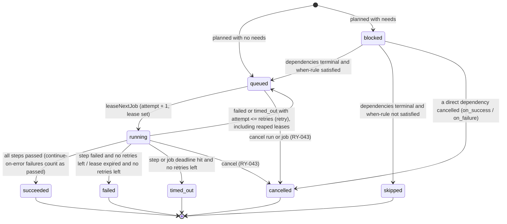
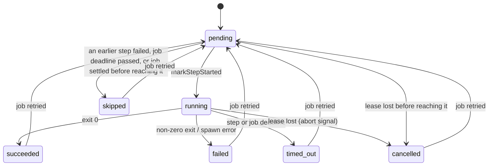
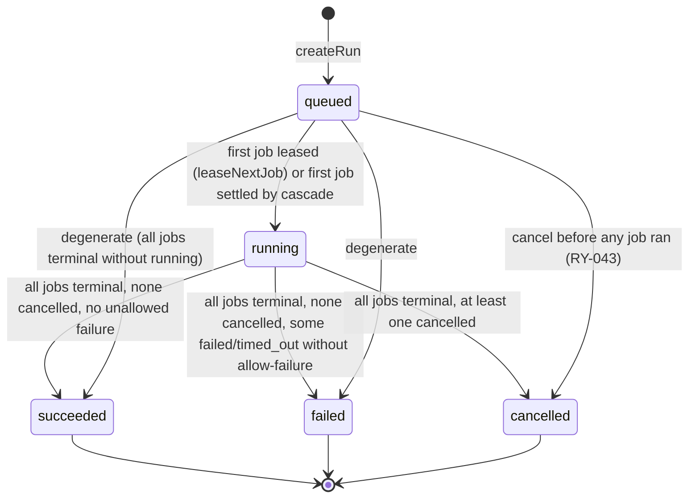
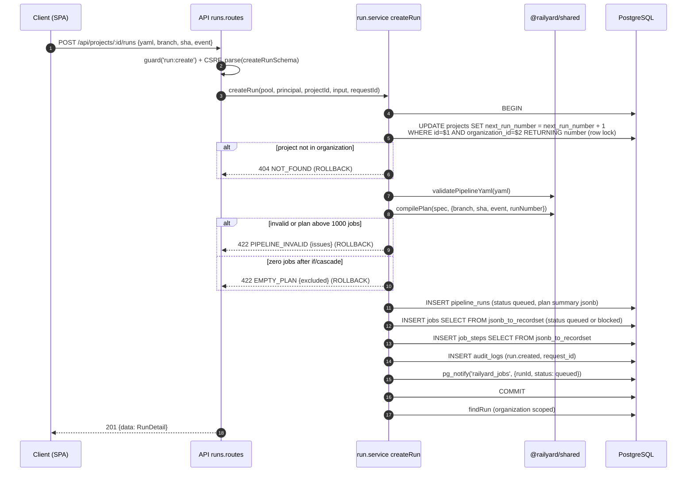

# System design

This document specifies how Railyard turns a pipeline file into executed jobs: the state machines, the interaction sequences between API, runners and Postgres, the core algorithms with their complexity, the concurrency and consistency strategy, and the hard limits. It is written against the code on `main`; planned behaviour is marked with its ticket.

Related: [../architecture/overview.md](../architecture/overview.md) (structure), [data-model.md](data-model.md) (tables), [../adr/README.md](../adr/README.md) (decisions).

---

## 1. Domain vocabulary

| Term           | Meaning                                                                                        | Code                                                      |
| -------------- | ---------------------------------------------------------------------------------------------- | --------------------------------------------------------- |
| Pipeline spec  | Validated, normalised form of `.railyard.yml`                                                  | `PipelineSpec` in `packages/shared/src/pipeline/types.ts` |
| Job (spec)     | A named unit with steps, stage, `needs`, `if`, `when`, matrix, timeout, retries                | `JobSpec`                                                 |
| Instance       | One matrix combination of a job; key `test[node=20,os=linux]`                                  | `instanceKey()`                                           |
| Execution plan | Instances with resolved needs, levels, interpolated env and scripts, exclusions, critical path | `ExecutionPlan`, produced by `compilePlan()`              |
| Run            | One execution of a plan, numbered per project                                                  | `pipeline_runs`                                           |
| Job (row)      | One planned instance inside a run                                                              | `jobs`                                                    |
| Attempt        | One lease of a job; `attempt` increments at each lease                                         | `jobs.attempt`, `job_log_chunks.attempt`                  |
| Lease          | Time-bound ownership of a running job by a runner                                              | `jobs.lease_owner`, `jobs.lease_expires_at`               |
| Level          | Length of the longest dependency chain ending at an instance (0 = no deps)                     | `jobs.level`                                              |

---

## 2. State machines

### 2.1 Job

Source of truth: `TRANSITIONS` in `packages/shared/src/jobs/state.ts`; the database enforces the status domain with a CHECK constraint and the invariant `(status = 'running') = (lease_owner IS NOT NULL)`.



Rules:

- Terminal statuses: `succeeded`, `failed`, `timed_out`, `cancelled`, `skipped`. No transition leaves a terminal status (`assertTransition` throws `InvalidTransitionError`).
- The `when`-rule for `blocked -> queued | skipped | cancelled` is decided by `resolveBlockedJobs` (section 4.8):

| `when`       | queued if                                                                  | else                                                      |
| ------------ | -------------------------------------------------------------------------- | --------------------------------------------------------- |
| `on_success` | every dependency `succeeded`, or `failed`/`timed_out` with `allow-failure` | `cancelled` if any dependency `cancelled`, else `skipped` |
| `on_failure` | some transitive ancestor `failed`/`timed_out` without `allow-failure`      | `cancelled` if any dependency `cancelled`, else `skipped` |
| `always`     | every dependency terminal                                                  | never                                                     |

- `running -> queued` on retry clears the lease, sets a new `queued_at` (the job goes to the back of the FIFO), keeps `exit_code` and `failure_reason` of the failed attempt for display, and resets all steps to `pending`.
- `cancelled` is reachable today only by cascade. Explicit cancellation (`POST /api/runs/:id/cancel`, `.../jobs/:jobId/cancel`) is registered as a pending route for RY-043.

### 2.2 Step



When a job settles, `settle()` closes out steps still `pending` (to `skipped`) or `running` (to the job's result family) so no step is left open.

### 2.3 Run

The run status is **derived**, never set independently: after every completion `advanceRun` recomputes it with `deriveRunStatus(jobs)`.



`deriveRunStatus`:

1. No jobs: `succeeded` (cannot occur in practice: empty plans are rejected with `422 EMPTY_PLAN`).
2. Any job not terminal: `running` if any job is `running` or already terminal, else `queued`.
3. Any job `cancelled`: `cancelled`.
4. Any job `failed`/`timed_out` without `allow-failure`: `failed`.
5. Otherwise `succeeded` (skipped jobs never fail a run).

`started_at` is set on the first transition out of `queued`; `finished_at` is set when the derived status is terminal.

---

## 3. Sequence diagrams

### 3.1 Create run



The project row lock serialises run numbering per project (verified by "numbers runs sequentially under concurrency" in `apps/api/test/runs.http.test.ts`). Validation and planning happen inside the lock; QA-01 bounds that time.

### 3.2 Lease, execute, complete

```mermaid
sequenceDiagram
  autonumber
  participant R as Runner loop
  participant DB as PostgreSQL
  participant X as executor (bash)
  participant L as LogWriter
  R->>DB: BEGIN; CTE SELECT id ... status='queued' ORDER BY queued_at,id<br/>FOR UPDATE SKIP LOCKED LIMIT 1
  R->>DB: UPDATE jobs SET running, attempt+1, lease_owner, lease_expires_at
  R->>DB: UPDATE pipeline_runs SET running WHERE status='queued'
  R->>DB: pg_notify(railyard_jobs, running); SELECT job_steps; COMMIT
  R->>L: new LogWriter(firstSeq = max(seq)+1, attempt)
  R->>R: createWorkspace(root/run/job-aN), start heartbeat timer (lease/3)
  loop each step in position order
    R->>DB: UPDATE job_steps SET running
    R->>X: runStep(script, cwd, env from scratch, min(step timeout, remaining job time), abort signal)
    X-->>L: stdout/stderr chunks -> mask -> buffer
    L->>DB: every 250 ms or 64 KiB: INSERT chunks (jsonb_to_recordset) + pg_notify(railyard_logs)
    X-->>R: {result, exitCode, durationMs}
    R->>DB: UPDATE job_steps SET result
    alt failed and not continue-on-error, or timed_out
      R->>DB: remaining steps -> skipped
    end
  end
  par heartbeat
    R->>DB: UPDATE jobs SET lease_expires_at WHERE id AND lease_owner AND running
    alt 0 rows (lease lost)
      R->>X: abort -> SIGTERM process group, SIGKILL after 3 s
    end
  end
  R->>L: close() (flush maskers + buffer)
  alt lease still held
    R->>DB: completeJob (section 3.4 transaction)
  else lease lost
    R->>R: discard result, log warning
  end
  R->>R: removeWorkspace unless RUNNER_KEEP_WORKSPACES
```

### 3.3 SSE log streaming with resume

```mermaid
sequenceDiagram
  autonumber
  participant B as Browser EventSource
  participant A as API logs.routes / sse.ts
  participant H as LogHub (1 LISTEN connection)
  participant DB as PostgreSQL
  participant R as Runner LogWriter
  B->>A: GET /logs/stream?after=0 (or Last-Event-ID: n)
  A->>A: guard('run:read'), findJobInOrganization
  A->>A: resumeFrom = Last-Event-ID if positive integer else after
  A->>H: subscribe(jobId, onEvent)
  A-->>B: 200 text/event-stream, retry: 2000
  A->>A: onEvent(status = current job status) (initial back-fill)
  A->>DB: SELECT chunks WHERE seq > lastSeq ORDER BY seq LIMIT 500 (repeat while full)
  A-->>B: event: log / id: seq / data: {seq, stream, content}
  R->>DB: INSERT chunks; pg_notify(railyard_logs, {jobId, seq}); COMMIT
  DB-->>H: notification
  H-->>A: {type: log, seq}
  A->>DB: drain() from lastSeq (chained, one at a time)
  A-->>B: event: log ...
  Note over B,A: network drop
  B->>A: reconnect with Last-Event-ID: lastSeq
  A->>DB: drain from lastSeq: no gap, no duplicate
  DB-->>H: railyard_jobs {jobId, status: succeeded}
  H-->>A: {type: status}
  A->>DB: final drain
  A-->>B: event: status {succeeded}, event: end
  A->>H: unsubscribe
```

Every 15 s a comment line `: keep-alive` is written. Closing the browser triggers `raw.on('close')`, which unsubscribes and stops the heartbeat.

### 3.4 Completion and the reaper

```mermaid
sequenceDiagram
  autonumber
  participant Rp as Reaper (any runner, every 10 s)
  participant Cj as completeJob
  participant DB as PostgreSQL
  participant P as @railyard/shared
  Rp->>DB: SELECT id FROM jobs WHERE running AND lease_expires_at < clock_timestamp()<br/>ORDER BY lease_expires_at LIMIT 100
  loop each expired job
    Rp->>Cj: completeJob(jobId, leaseOwner: null, result: failed, reason: 'lease expired (runner lost)')
    Cj->>DB: BEGIN; SELECT run FOR UPDATE OF r (run row lock)
    Cj->>DB: SELECT job FOR UPDATE; still running? owner matches (or system actor)?
    alt not running any more (completed concurrently)
      Cj-->>Rp: applied: false (COMMIT, no change)
    end
    Cj->>P: outcomeAfterAttempt(result, attempt, retries)
    alt attempt <= retries
      Cj->>DB: UPDATE job -> queued, clear lease, new queued_at; steps -> pending
    else settle
      Cj->>DB: UPDATE job -> failed, finished_at; close out steps
    end
    Cj->>DB: pg_notify(railyard_jobs)
    Cj->>DB: SELECT all jobs of run
    Cj->>P: resolveBlockedJobs(jobs) -> changes
    Cj->>DB: UPDATE jobs ... WHERE key = ANY($keys) AND status='blocked' (per target status)
    Cj->>DB: UPDATE job_steps -> skipped for newly skipped/cancelled jobs
    Cj->>P: deriveRunStatus(final statuses)
    Cj->>DB: UPDATE pipeline_runs status, started_at, finished_at
    Cj->>DB: pg_notify per promoted job; COMMIT
  end
```

A runner's own completion follows the same transaction with `leaseOwner = runner name`.

---

## 4. Core algorithms

Notation: _B_ = YAML bytes, _J_ = jobs in the spec, _N_ = total `needs` entries, _A_ = matrix axes, _C_ = combinations of one matrix, _I_ = planned instances (<= 1000), _E_ = edges between instances, _S_ = stages, _k_ = secrets, _L_ = longest secret length.

### 4.1 Validation (`validatePipelineYaml`)

1. `loadYaml`: size check on UTF-8 bytes (256 KiB), `parseDocument` with `uniqueKeys` and a `LineCounter`; syntax errors become `yaml_syntax` issues with line/column. Conversion to JS caps alias expansion at 50 (protects against alias bombs).
2. Structural readers walk the document once, normalising and recording issues (`type`, `required`, `unknown_key`, `pattern`, `range`, `enum`, `too_many`, `too_long`, `duplicate`, `unsafe_path`, ...).
3. `checkSemantics`: per job, stage membership, `needs` checks (`unknown_job`, `self_dependency`, `later_stage`), matrix size, expression and template parsing with reference scope checks, `not_yet_executed` warnings; then one cycle search on the explicit-needs graph.
4. Each issue's raw path is resolved to a source position by walking up the path until a node with a range exists.

Complexity: O(B) parse; O(B) structural walk; O(J + N) needs and cycle checks; O(total expression length) for expressions; O(depth) per issue for position lookup. Matrix size check: an O(A) arithmetic upper bound (`matrixUpperBound`) rejects oversized matrices first; only matrices within 16x the limit are expanded, costing O(C·A) (see 4.3).

### 4.2 Expressions

Tokenizer O(n) with n <= 1024; recursive-descent parser O(tokens) with precedence `!` > `==`/`!=` > `&&` > `||`; evaluation is a tree walk O(nodes). `&&`/`||` short-circuit. Recursion depth is bounded by the expression length cap. Interpolation finds placeholders with a non-greedy pattern and evaluates each: O(template length + Σ expression nodes).

### 4.3 Matrix expansion (`expandMatrix`)

1. Cartesian product by reduce: O(C·A) time and space, first axis slowest.
2. Exclude: O(C·X·A) for X exclude entries (partial, string-coerced match).
3. Include: for each of the _M_ include entries, scan all slots and merge into product-derived slots whose original axis values match: O(M·C·A). Unmatched entries are appended and never absorb later includes.

Total O(C·A·(1 + X + M)). With limits (C <= 256 after expansion, A <= 8) this is trivial. The product before excludes could reach 64^A, so the validator computes `matrixUpperBound` (product of axis lengths plus include entries) in O(A) and refuses anything above 4096 before expanding.

### 4.4 Cycle detection (`findCycle`)

Iterative three-colour DFS (white = unvisited, grey = on the current path, black = finished). Each stack frame stores the node and the index of the next dependency to explore, so no recursion is used and very deep chains (tested with long chains in `dag.test.ts`) cannot overflow the call stack. Meeting a grey node means a back edge: the cycle is the stack slice from that node plus the node again (`['a','b','a']`), reported as `dependency cycle: a -> b -> a`.

Complexity: O(V + E) time, O(V) space; the slice on detection is O(depth) once.

### 4.5 Topological levels (`topologicalLevels`)

Kahn's algorithm processed frontier by frontier: level 0 = nodes with no dependencies; each subsequent frontier contains the nodes whose remaining-dependency count reached zero. A node's level therefore equals the length of its longest dependency chain. Each frontier is sorted by original input position, which makes plans deterministic (`dag.test.ts`, "keeps input order within a level"; `plan.test.ts`, "is deterministic"). Unknown dependencies and cycles throw.

Complexity: O(V + E) for the traversal plus O(V log V) total for frontier sorting.

The planner uses it twice: on job ids to order explicit-needs processing, and on instance keys to assign `level`. The run graph UI draws one column per level.

### 4.6 Critical path (`criticalPath`)

Longest weighted path via dynamic programming over the level order: for each node, pick the predecessor with the highest accumulated cost, `cost(node) = weight(node) + cost(best predecessor)`; the tail is the node with the maximum cost; follow `prev` pointers back. Default weight is 1 per node (longest chain by job count). Planned: weight by historical p50 duration once metrics exist (RY-110).

Complexity: O(V + E).

### 4.7 Plan compilation (`compilePlan`)

```
for job in explicit-needs topological order:            O(J + N)
    if any explicit need has zero instances:
        exclude(job, "needs 'x', which is excluded")    cascade
    else:
        instances = expandMatrix(job.matrix) filtered by if: per instance
        if none: exclude(job, "if condition is false")
if total instances > 1000: PlanError -> 422 plan_too_large
for each instance: needs = explicit (all instances of each need)
                   or implicit (all instances of previous non-empty stage)
levels = topologicalLevels(instance graph)
criticalPath(instance graph)
for each instance: interpolate name, job env, step env, step scripts;
                   env = builtins (CI, RAILYARD_*, MATRIX_*) + pipeline env + job env
```

Complexity: expansion O(Σ C·A); implicit-needs resolution O(I·(J + I_prev)) where I_prev is the instance count of the previous non-empty stage; graph work O(I + E) with E <= I²/4 in the worst case (two adjacent stages of I/2 instances under implicit dependencies); interpolation O(I × total template size). The planner is pure and deterministic: identical inputs give identical plans.

### 4.8 Dependency resolution (`resolveBlockedJobs`)

```
current = map key -> job
repeat until no change in a full pass:
    for job in current where status = blocked:
        deps = job.needs mapped to current (unknown keys ignored)
        if any dep not terminal: continue
        next = decide(job, deps)             (table in section 2.1)
        record change; current[job] = job with status next
```

Because `current` is updated within a pass, a chain listed in dependency order resolves in a single pass; in the worst case each pass resolves one more level, so passes <= depth + 1. `on_failure` checks transitive ancestry with an iterative DFS (`ancestorFailed`), O(V + E) per such job.

Complexity: O(passes × (V + E)) plus O(F × (V + E)) for F `on_failure` jobs; worst case O(V·(V + E)). It is pure: input is not mutated; output is a list of `{key, from, to}`.

### 4.9 Retry decision (`outcomeAfterAttempt`)

`failed` or `timed_out` with `attempt <= retries` gives `queued` with `retry: true`; anything else settles with the attempt's result. Since `attempt` is incremented at lease time, `retries: 2` allows three attempts in total. Backoff and retryable exit codes are RY-046.

### 4.10 Cron `nextRun`

Starting one minute after `after` (seconds zeroed), loop:

- month not allowed: jump to the first day of the next month, 00:00;
- day not allowed (Vixie rule: if both day fields are restricted, either may match): next day 00:00;
- no allowed hour >= current hour: next day 00:00; if a later hour is allowed, jump to it at minute 0;
- no allowed minute >= current minute: next hour, minute 0;
- otherwise return.

Each iteration either returns or advances by at least one of month/day/hour. On a fresh matching day both lookups succeed immediately, so the work is dominated by skipping non-matching months and days: at most about 9 × (12 + 366) ≈ 3 400 iterations across the 9-year window (needed for Feb 29 schedules), each O(60) for the sorted-array lookups. Impossible schedules (`0 0 30 2 *`) return `null` at the window end. Verified against a brute-force minute scan in `packages/shared/test/cron.test.ts`.

### 4.11 Streaming secret masker

State: `pending` tail string. `push(chunk)`: `text = pending + chunk`; replace each secret (longest first) with `***`; find the longest suffix of the masked text, up to L - 1 characters, that is a prefix of some secret; emit everything before it, keep it as `pending`. `flush()` masks and emits the tail.

Complexity per chunk: O(k·n) for replacement plus O(L·k·L) for the suffix search; added latency is at most L - 1 characters and only when the tail actually looks like a secret prefix. Chunking-independence is a property test in `packages/shared/test/logs.test.ts`.

### 4.12 Log writer batching

`write()` masks, then appends to a buffer, coalescing consecutive writes to the same stream into one pending chunk. Flush triggers: 250 ms timer, 64 KiB buffered, `close()`. A flush assigns consecutive `seq` values, issues one set-based INSERT and one NOTIFY carrying the last `seq`. Flushes are chained so they never overlap and `seq` stays monotonic. After 5 MiB per attempt, further output is dropped with one system notice.

---

## 5. Concurrency and consistency strategy

All transactions run at Postgres's default READ COMMITTED isolation; correctness comes from explicit row locks, guarded updates and constraints, not from SERIALIZABLE.

| Operation                                | Transaction scope       | Locks taken                                                                | Guards and invariants                                                                                 |
| ---------------------------------------- | ----------------------- | -------------------------------------------------------------------------- | ----------------------------------------------------------------------------------------------------- |
| Reserve run number                       | `createRun` transaction | Row lock on `projects` via `UPDATE ... RETURNING`                          | `organization_id` predicate; `UNIQUE (project_id, number)`                                            |
| Persist plan                             | same transaction        | none beyond inserts                                                        | `UNIQUE (run_id, key)`, `UNIQUE (job_id, position)`; run is invisible until COMMIT                    |
| Lease                                    | own transaction         | `FOR UPDATE SKIP LOCKED` on one queued job; run row via conditional update | `CHECK ((status='running') = (lease_owner IS NOT NULL))`                                              |
| Heartbeat                                | autocommit              | momentary row lock                                                         | `WHERE lease_owner = $owner AND status = 'running'`; 0 rows means lost                                |
| Complete (runner, reaper, future cancel) | own transaction         | run row `FOR UPDATE OF r`, then job row `FOR UPDATE`                       | owner check (or system actor); `status = 'running'` check; promotions guarded by `status = 'blocked'` |
| Log insert                               | autocommit per flush    | none                                                                       | `UNIQUE (job_id, seq)`                                                                                |
| Migrations                               | per file                | `pg_advisory_lock(41050001)` session lock                                  | checksum verification                                                                                 |

Invariants and how they are maintained:

1. **At most one owner per running job.** Only the lease transaction sets `lease_owner`, and only on a row it locked with SKIP LOCKED while `status = 'queued'`.
2. **No late results.** Completion requires the caller to still be the owner; reaped or requeued jobs reject the old owner.
3. **No lost promotions.** Completions in one run are serialised by the run row lock and recompute from a consistent snapshot ([ADR-0004](../adr/0004-serialise-completion-by-locking-run-row.md)).
4. **Run status equals the derivation of its jobs**, because it is only ever written by `advanceRun` (and by the lease path moving `queued -> running`, which the derivation agrees with).
5. **Observers never see uncommitted state.** NOTIFY is delivered after COMMIT; SSE reads committed chunks by `seq`.
6. **Tenant isolation.** Every route-reachable query filters by `organization_id` from the session principal.

Lock ordering: completion always locks run then job. The lease path locks a job then updates its run (only from `queued`). Both orders touch the same pair, so a deadlock is theoretically possible when a lease of job B and a completion of job A in the same run interleave exactly; the run update in the lease path is conditional and very short, and Postgres would abort one side, which the runner loop retries on the next iteration. RY-141 will measure whether this ever occurs under load; if it does, the lease path will lock the run row first with `NOWAIT` semantics.

Hardening already in place:

- Step status updates (`markStepStarted`, `markStepFinished`) are fenced by the lease: the `UPDATE` joins `jobs` and only applies while `lease_owner` is the calling runner and the job is `running`. A runner that lost its lease but has not yet observed it cannot touch the steps of a requeued attempt; a failed fence on step start aborts the attempt (`runner.db.test.ts`, "lease fencing").
- Log flushes never reject: a failed `INSERT` puts the batch back at the front of the buffer, reuses its sequence numbers and reports through `onError`; the next timer flush or `close()` retries it, so a transient database error neither crashes the runner nor loses output (`runner.db.test.ts`, "keeps logging when a flush fails"). Backoff and batching across many jobs remain part of RY-066.

---

## 6. Limits

Pipeline limits live in `packages/shared/src/pipeline/limits.ts` (`PIPELINE_LIMITS`); others are constants in the modules named.

| Limit                                   | Value                                | Enforced in                                | Error                  |
| --------------------------------------- | ------------------------------------ | ------------------------------------------ | ---------------------- |
| Pipeline YAML size                      | 256 KiB (UTF-8 bytes)                | `loadYaml`; request schema caps characters | `yaml_too_large`       |
| YAML alias expansions                   | 50                                   | `doc.toJS({ maxAliasCount: 50 })`          | `yaml_syntax`          |
| Jobs per pipeline                       | 200                                  | validator                                  | `too_many`             |
| Steps per job                           | 100                                  | validator                                  | `too_many`             |
| Stages                                  | 30                                   | validator                                  | `too_many`             |
| Matrix axes                             | 8                                    | validator                                  | `too_many`             |
| Values per axis                         | 64                                   | validator                                  | `too_many`             |
| Combinations per matrix                 | 256                                  | validator (`checkMatrixSize`)              | `matrix_too_large`     |
| Planned jobs per run                    | 1000                                 | planner                                    | `plan_too_large` (422) |
| Job / step timeout                      | 1 to 1440 minutes, default 60        | validator                                  | `range`                |
| Retries                                 | 0 to 5                               | validator and DB CHECK                     | `range`                |
| Identifier pattern (job ids, stages)    | `^[A-Za-z][A-Za-z0-9_-]{0,62}$`      | validator                                  | `pattern`              |
| Env variable name                       | `^[A-Za-z_][A-Za-z0-9_]{0,127}$`     | validator                                  | `pattern`              |
| Duration (artifact expiry)              | `^\d{1,4}(m\|h\|d\|w)$`              | validator                                  | `pattern`              |
| Expression length                       | 1024 characters                      | tokenizer                                  | `expression_syntax`    |
| Step script                             | 64 KiB                               | validator                                  | `too_long`             |
| Cron expression                         | 120 characters, 9-year search window | validator, `nextRun`                       | `invalid_cron`         |
| Request body                            | 512 KiB                              | Fastify `bodyLimit`                        | `PAYLOAD_TOO_LARGE`    |
| Log output per attempt                  | 5 MiB, then truncated                | `LogWriter`                                | system notice in log   |
| Log flush                               | 250 ms or 64 KiB                     | `LogWriter`                                | n/a                    |
| Log page size                           | 1 to 5000, default 1000              | `logs.routes`                              | `VALIDATION_FAILED`    |
| SSE back-fill batch / heartbeat / retry | 500 chunks / 15 s / 2000 ms          | `sse.ts`                                   | n/a                    |
| Run list page size                      | 1 to 100, default 25                 | `paginationSchema`                         | `VALIDATION_FAILED`    |
| Lease length                            | 5 to 600 s, default 30               | `RUNNER_LEASE_SECONDS`                     | config error at boot   |
| Runner poll interval                    | 50 to 60 000 ms, default 1000        | `RUNNER_POLL_MS`                           | config error at boot   |
| Reaper interval / batch                 | 10 s / 100 jobs                      | `runner.ts`, `lease.ts`                    | n/a                    |
| Kill grace after SIGTERM                | 3 s                                  | `executor.ts`                              | n/a                    |
| Session TTL                             | 1 to 720 h, default 168              | `SESSION_TTL_HOURS`                        | config error           |
| Password length                         | 12 to 256 characters                 | `registerSchema`                           | `VALIDATION_FAILED`    |
