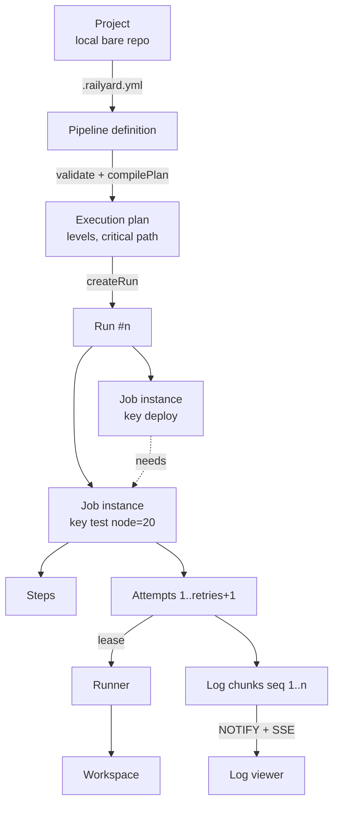

# Glossary

Domain vocabulary used across Railyard's code, API and documentation. Where a term maps to code, the module is named; where a feature is not built yet, the delivering ticket is given.

## How the core terms relate

## Terms

| Term                           | Definition                                                                                                                                                                                                                                                                                                                                                                              |
| ------------------------------ | --------------------------------------------------------------------------------------------------------------------------------------------------------------------------------------------------------------------------------------------------------------------------------------------------------------------------------------------------------------------------------------- |
| **Allow-failure**              | Job flag (`allow-failure: true`). A failed or timed-out job with this flag counts as _satisfied_ for its `on_success` dependents and does not make the run fail. It still shows as failed. See `packages/shared/src/jobs/state.ts`.                                                                                                                                                     |
| **always**                     | Value of `when`. The job is queued once every dependency is terminal, regardless of outcome. Used for cleanup and reporting jobs.                                                                                                                                                                                                                                                       |
| **ANSI / SGR**                 | Terminal escape sequences. Railyard renders SGR (Select Graphic Rendition) codes: 16 colours, bright, 256-colour and truecolor foreground/background, bold, italic, underline. Cursor movement and OSC sequences are dropped. Style state carries across chunks. `packages/shared/src/logs/ansi.ts`.                                                                                    |
| **API envelope**               | Every JSON response has the shape `{ data, error: { code, message, details? } \| null, meta? }`.                                                                                                                                                                                                                                                                                        |
| **Approval (gate)**            | A pause before a job that deploys to a protected environment until a required reviewer approves or rejects. The requester cannot approve their own run. Planned in RY-091.                                                                                                                                                                                                              |
| **Archival (logs)**            | Moving finished job logs from Postgres to compressed files on local disk while keeping them readable. Planned in RY-064.                                                                                                                                                                                                                                                                |
| **Artifact**                   | Files produced by a job (`artifacts.paths`) and stored in the local artifact store with an expiry (`expire-in`, e.g. `7d`). Can be downloaded or passed to dependent jobs. Validated today, executed from RY-080.                                                                                                                                                                       |
| **Attempt**                    | One execution of a job. `jobs.attempt` increments on every lease; logs record the attempt that produced them. A job has at most `retries + 1` automatic attempts.                                                                                                                                                                                                                       |
| **Audit log**                  | Append-only `audit_logs` rows recording actor, organization, action (e.g. `auth.login`, `run.created`), target, request id and IP. Query API planned in RY-026.                                                                                                                                                                                                                         |
| **Backoff (login)**            | Per-email progressive lockout: after `LOGIN_EMAIL_FREE_ATTEMPTS` failures the wait doubles from `LOGIN_BACKOFF_BASE_SECONDS` up to `LOGIN_BACKOFF_MAX_SECONDS`, independent of source IP. Complemented by a per-IP attempt limit and a per-IP cap on distinct emails (`LOGIN_MAX_EMAILS_PER_IP`). Attempts are reserved before any database call so parallel requests cannot overshoot. |
| **Client IP key**              | The value rate limiters key on: the client address as resolved under `TRUST_PROXY` (which must be explicit in production), with IPv6 addresses collapsed to their /64 prefix. `apps/api/src/http/client-ip.ts`.                                                                                                                                                                         |
| **Bare repository**            | A git repository without a working tree (`git init --bare`), on the same host as Railyard. The only supported source of code; Railyard polls it and never calls a forge API.                                                                                                                                                                                                            |
| **Blocked**                    | Job status for a planned job that has dependencies not yet terminal. Transitions to `queued`, `skipped` or `cancelled`.                                                                                                                                                                                                                                                                 |
| **Cache**                      | Directory contents saved after a successful job under an interpolated `cache.key` and restored into later jobs with the same key. Validated today, executed from RY-083; LRU eviction per project in RY-084.                                                                                                                                                                            |
| **Cancel**                     | Stopping a run or job: queued and blocked jobs become `cancelled`; running jobs get their process group signalled. The executor already supports abort; the API is planned in RY-043.                                                                                                                                                                                                   |
| **Cascade exclusion**          | Planner rule: when every instance of a job is excluded (its `if:` is false), jobs that explicitly `need` it are excluded too, with a reason recorded in `plan.excluded`.                                                                                                                                                                                                                |
| **Chunk (log chunk)**          | A row of `job_log_chunks`: `(job_id, seq)` unique, `attempt`, `stream` (`stdout`, `stderr`, `system`) and `content`. Consecutive writes to the same stream are coalesced before persisting.                                                                                                                                                                                             |
| **Concurrency group**          | A named key (e.g. `deploy-${{ branch }}`) allowing only one active member at a time; newcomers either queue or cancel the in-progress member. Validated today, executed from RY-095.                                                                                                                                                                                                    |
| **continue-on-error**          | Step flag. When the step fails, the job proceeds to the next step instead of stopping; the step is recorded as failed.                                                                                                                                                                                                                                                                  |
| **Critical path**              | The longest chain of dependent job instances in the plan, computed over topological levels in O(V+E). It bounds the minimum run duration. `criticalPath` in `packages/shared/src/pipeline/dag.ts`.                                                                                                                                                                                      |
| **Cron**                       | Five-field schedule expression (`minute hour day-of-month month day-of-week`) in the Vixie dialect: lists, ranges, steps, names (`JAN`, `MON`), `7` as Sunday, macros `@yearly` to `@hourly`. When both day fields are restricted, a day matches if either matches. Evaluated in UTC today (`packages/shared/src/cron/cron.ts`); time zones in RY-103.                                  |
| **CSRF token**                 | Per-session random token returned by `GET /api/auth/me` and required in the `x-csrf-token` header on every mutating request.                                                                                                                                                                                                                                                            |
| **DAG**                        | Directed acyclic graph of job instances whose edges are `needs`. Cycles are rejected at validation with the cycle path printed.                                                                                                                                                                                                                                                         |
| **Deployment**                 | A record that a job deployed a commit to an environment, with outcome and actor. Planned in RY-090.                                                                                                                                                                                                                                                                                     |
| **Drain**                      | Graceful runner shutdown: stop leasing, let running jobs finish within a timeout, then go offline. Planned in RY-055.                                                                                                                                                                                                                                                                   |
| **Environment**                | A named deployment target (e.g. `staging`, `production`) with history, protection rules and approval requirements. Validated as a job key today; executed from RY-090.                                                                                                                                                                                                                  |
| **Excluded job**               | A job removed from the plan for this run, with a reason (condition false, or cascade). Excluded jobs are not persisted as jobs.                                                                                                                                                                                                                                                         |
| **Expression**                 | The language inside `if:` and `${{ }}`: literals, references (`branch`, `sha`, `event`, `run_number`, `matrix.*`, `env.*`), `!`, `&&`, `\|\|`, `==`, `!=`, parentheses and functions `startsWith`, `endsWith`, `contains`. `packages/shared/src/pipeline/expression.ts`.                                                                                                                |
| **Execution plan**             | Output of `compilePlan`: planned job instances with resolved needs, level, steps (interpolated), plus `levels`, `excluded` and `criticalPath`. Stored in `pipeline_runs.plan`. Pure and deterministic.                                                                                                                                                                                  |
| **Fair share**                 | Scheduling policy choosing the project with the lowest served-to-weight ratio before FIFO order within a project. Planned in RY-097.                                                                                                                                                                                                                                                    |
| **Heartbeat**                  | Periodic lease extension by the runner holding a job (`extendLease`). Returns false when the lease has been lost, which makes the runner abort the job and discard its result.                                                                                                                                                                                                          |
| **include / exclude (matrix)** | `exclude` entries remove combinations that match all their keys. `include` entries are merged into every combination whose original axis values they do not overwrite, or appended as a new combination if they fit none.                                                                                                                                                               |
| **Instance key**               | Stable identifier of a job instance inside a run, e.g. `test[node=20,os=linux]` for a matrix instance or `deploy` otherwise. Unique per run (`jobs.key`).                                                                                                                                                                                                                               |
| **Interpolation**              | Replacement of `${{ expression }}` placeholders in names, env values and scripts at plan time, per matrix instance.                                                                                                                                                                                                                                                                     |
| **Job**                        | A unit of work in a pipeline: steps executed sequentially in one workspace on one runner, with `needs`, `when`, `if`, `matrix`, `timeout-minutes`, `retries` and `allow-failure`.                                                                                                                                                                                                       |
| **Job instance**               | One concrete job in a run after matrix expansion. Each instance has its own status, attempts, steps and logs.                                                                                                                                                                                                                                                                           |
| **Job status**                 | `blocked`, `queued`, `running`, `succeeded`, `failed`, `timed_out`, `cancelled`, `skipped`. The last five are terminal. Allowed transitions are enforced by `canTransition`.                                                                                                                                                                                                            |
| **Last-Event-ID**              | HTTP header a browser's `EventSource` sends on reconnect containing the `id` of the last SSE event received. Railyard uses the log `seq` as the event id, so the stream resumes exactly after it.                                                                                                                                                                                       |
| **Lease**                      | Temporary ownership of a running job by one runner: `lease_owner` plus `lease_expires_at`, computed with the database clock. Default TTL `RUNNER_LEASE_SECONDS` = 30.                                                                                                                                                                                                                   |
| **Level**                      | Topological depth of a job instance: level 0 has no dependencies; level n has a longest dependency chain of n. The run graph draws one column per level.                                                                                                                                                                                                                                |
| **LISTEN / NOTIFY**            | PostgreSQL publish/subscribe. Runners and the API `NOTIFY` on `railyard_logs` and `railyard_jobs` with small JSON payloads (ids and seq only); each API process holds one `LISTEN` connection in the log hub. Notifications are delivered only after commit.                                                                                                                            |
| **Log hub**                    | In-process multiplexer mapping one LISTEN connection to many SSE subscribers keyed by job id, with reconnect on error. `apps/api/src/modules/logs/log-hub.ts`.                                                                                                                                                                                                                          |
| **Masker**                     | Streaming secret masker replacing secret values (at least 4 characters) with `***`. Holds back up to (longest secret - 1) characters per stream so secrets split across chunks are still caught. `packages/shared/src/logs/mask.ts`.                                                                                                                                                    |
| **Matrix**                     | Job key declaring axes (up to 8 axes, 64 values each); the job expands into one instance per combination (at most 256), in axis declaration order.                                                                                                                                                                                                                                      |
| **max-parallel**               | Matrix option limiting how many instances run at once. Planned in RY-096.                                                                                                                                                                                                                                                                                                               |
| **needs**                      | Explicit dependencies of a job. Omitted means _implicit_: depend on every job of the previous non-empty stage. `needs: []` means start immediately. A job cannot need a job in a later stage.                                                                                                                                                                                           |
| **on_failure**                 | Value of `when`. The job is queued only if some transitive ancestor failed (without allow-failure); otherwise skipped.                                                                                                                                                                                                                                                                  |
| **on_success**                 | Default `when`. The job is queued when all dependencies succeeded or failed with allow-failure; otherwise skipped.                                                                                                                                                                                                                                                                      |
| **Organization**               | Tenant boundary. Every project, run and job row carries `organization_id`, and every query filters by it.                                                                                                                                                                                                                                                                               |
| **Outbox**                     | Local file sink for email-like messages (invitations, password resets, notifications). Nothing is sent through an external provider. Planned in RY-024, RY-131.                                                                                                                                                                                                                         |
| **Pending route**              | A planned endpoint registered with real authentication and permission checks that answers `501 NOT_IMPLEMENTED` with its ticket id.                                                                                                                                                                                                                                                     |
| **Permission**                 | One of `project:read`, `project:write`, `pipeline:validate`, `run:read`, `run:create`, `run:cancel`, `secret:write`, `runner:manage`, `org:manage`, `audit:read`. Granted through roles.                                                                                                                                                                                                |
| **Pipeline**                   | The YAML definition (`version`, `name`, `on`, `env`, `stages`, `jobs`) describing what to run and when. Today supplied with the run request; read from `.railyard.yml` at the commit from RY-014.                                                                                                                                                                                       |
| **Poller**                     | Process that runs `git for-each-ref` against each project's bare repository, diffs refs and starts runs for matching pushes. Planned in RY-012, RY-016.                                                                                                                                                                                                                                 |
| **Process group**              | Every step is spawned detached as its own process group; timeouts and cancellation send SIGTERM and later SIGKILL to the whole group so child processes do not survive.                                                                                                                                                                                                                 |
| **Reaper**                     | Periodic task (every 10 s in each runner) that settles jobs whose lease expired as failed attempts with reason "lease expired (runner lost)", so the normal retry policy decides between requeue and failure.                                                                                                                                                                           |
| **Retry**                      | Automatic: a failed or timed-out attempt is requeued while `attempt <= retries` (max 5). Manual retry and backoff are planned in RY-044 and RY-046.                                                                                                                                                                                                                                     |
| **Role**                       | `owner` (all permissions), `admin` (all except `org:manage`), `developer` (read, validate, create and cancel runs), `viewer` (read only).                                                                                                                                                                                                                                               |
| **Run**                        | One execution of a pipeline for a branch, SHA and event, numbered per project (`#1`, `#2`, ...). Status `queued`, `running`, `succeeded`, `failed` or `cancelled`, derived from its jobs.                                                                                                                                                                                               |
| **Runner**                     | A process that registers in `runners`, then loops: lease a job, create a workspace, execute steps, write logs, complete. Many runners coordinate solely through Postgres row locks.                                                                                                                                                                                                     |
| **runs-on**                    | Job labels a runner must carry to lease it. Stored today; matching enforced from RY-053.                                                                                                                                                                                                                                                                                                |
| **Seq**                        | Per-job, strictly increasing sequence number of log chunks, continuous across attempts. Used as the SSE event id.                                                                                                                                                                                                                                                                       |
| **Session**                    | Server-side login state in `sessions`; the cookie holds a random token and the table stores only its HMAC-SHA256 under `SESSION_SECRET`.                                                                                                                                                                                                                                                |
| **Skipped**                    | Terminal job status when the job's `when` condition is not met after its dependencies settle (e.g. an `on_success` job after a failure). Skips propagate down chains in one pass.                                                                                                                                                                                                       |
| **SKIP LOCKED**                | PostgreSQL row-locking option (`FOR UPDATE SKIP LOCKED`) that makes a claimer skip rows locked by other transactions instead of waiting. Lets many runners pull from one queue without double-claiming or blocking.                                                                                                                                                                     |
| **SSE**                        | Server-Sent Events: a long-lived `text/event-stream` HTTP response. Railyard emits `log` (with `id: seq`), `status` and `end` events, keep-alive comments every 15 s and `retry: 2000`.                                                                                                                                                                                                 |
| **Stage**                      | Ordered grouping of jobs (`stages: [build, test, deploy]`, max 30). Stages define implicit dependencies; jobs without a stage go to `default`.                                                                                                                                                                                                                                          |
| **Step**                       | One shell script inside a job, run with `bash --noprofile --norc -eo pipefail`, with optional `env`, `timeout-minutes`, `continue-on-error` and `working-directory` (must stay inside the workspace).                                                                                                                                                                                   |
| **Timeout**                    | Limit on a step or job (`timeout-minutes`, default 60, max 1440). Exceeding it kills the process group and marks the step and job `timed_out`.                                                                                                                                                                                                                                          |
| **Trigger**                    | What starts a run: `push`, `manual`, `schedule` or `api`. Push matching with branch globs is planned in RY-016; schedules in RY-102.                                                                                                                                                                                                                                                    |
| **Validation issue**           | `{ severity, code, path, message, line?, column? }`. Errors (e.g. `unknown_job`, `cycle`, `too_many`, `invalid_cron`, `unsafe_path`) make the pipeline invalid; warnings (e.g. `not_yet_executed`) do not.                                                                                                                                                                              |
| **when**                       | Job key choosing promotion semantics after dependencies settle: `on_success` (default), `on_failure` or `always`.                                                                                                                                                                                                                                                                       |
| **Workspace**                  | Per-attempt working directory `<WORKSPACE_ROOT>/<runId>/<jobId>-a<attempt>` with `HOME` and `TMPDIR` inside it. Removed after the job unless `RUNNER_KEEP_WORKSPACES=true`. Checkout of the commit is planned in RY-015; disk quotas in RY-057.                                                                                                                                         |
