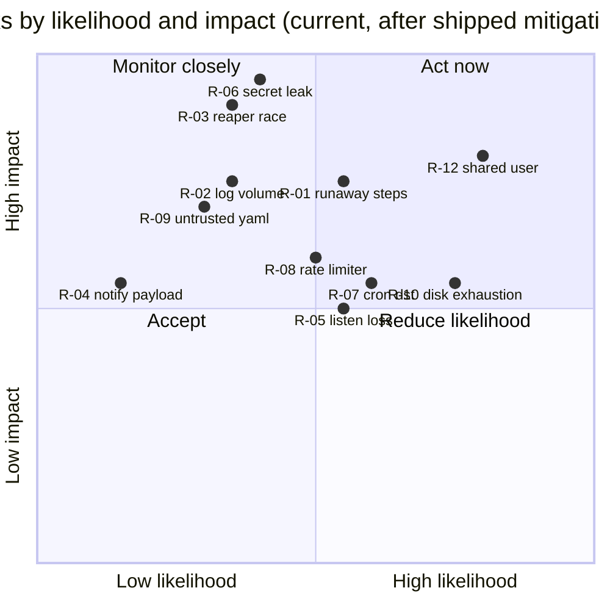

# Risk Register

Domain risks for Railyard, reviewed at every milestone boundary. Likelihood and impact use a 1-5 scale (5 = almost certain / severe); **score = likelihood x impact**. Status: `open` (no mitigation in code yet), `mitigating` (partial mitigation shipped, follow-up ticket pending), `mitigated` (controls implemented and tested; residual risk accepted), `closed`.

Owner roles: **Runner lead** (E6), **Platform lead** (E1/E15 operations), **Security lead** (E2/E8), **Backend lead** (E4/E5/E7), **Product** (scope and priorities).

## Heat map

## Register

| ID   | Risk                                                                                                                                                                                                                                  | Likelihood | Impact | Score | Mitigation (shipped / planned)                                                                                                                                                                                                                                                                                                                                                                                                                                                                                                                                                                               | Owner         | Status     |
| ---- | ------------------------------------------------------------------------------------------------------------------------------------------------------------------------------------------------------------------------------------- | ---------: | -----: | ----: | ------------------------------------------------------------------------------------------------------------------------------------------------------------------------------------------------------------------------------------------------------------------------------------------------------------------------------------------------------------------------------------------------------------------------------------------------------------------------------------------------------------------------------------------------------------------------------------------------------------ | ------------- | ---------- |
| R-01 | **Runaway shell steps.** A step forks background processes, ignores SIGTERM or never exits, holding a runner slot and host resources indefinitely; orphans survive the job.                                                           |          3 |      4 |    12 | Shipped: every step runs in its own process group (`detached: true`) and timeouts or cancellation signal `-pid` with SIGTERM then SIGKILL after a grace period (`apps/api/src/runner/executor.ts`); job timeout default 60 min, max 24 h enforced by the validator. Planned: cgroups v2 scopes via `systemd-run` so double-forked daemons that escape the group are still killed (RY-054); user-namespace sandbox (RY-058).                                                                                                                                                                                  | Runner lead   | mitigating |
| R-02 | **Log volume.** A chatty or looping step writes gigabytes into `job_log_chunks`, bloating Postgres, slowing vacuum and backups.                                                                                                       |          2 |      4 |     8 | Shipped: hard cap of 5 MiB per attempt with a single truncation notice, batching (flush every 250 ms or 64 KiB, one INSERT + one NOTIFY per flush) in `apps/api/src/runner/log-writer.ts`. Planned: archival of finished logs to gzip files and retention (RY-064), retention jobs (RY-143).                                                                                                                                                                                                                                                                                                                 | Backend lead  | mitigating |
| R-03 | **Lease reaping races.** A slow but alive runner has its lease reaped and the job re-queued, so two processes execute the same job or a late result overwrites the retry's state.                                                     |          2 |      5 |    10 | Shipped: completion verifies `lease_owner` inside a transaction that locks the run row and the job row (`completeJob` in `apps/api/src/modules/runs/run-progress.ts`); heartbeat `extendLease` returns false when the lease is gone and the runner aborts and discards results; `CHECK ((status = 'running') = (lease_owner IS NOT NULL))`; leases use `clock_timestamp()` on the database clock, not runner clocks. Residual: side effects of the stale attempt (for example a deploy) may already have happened; approval gates and concurrency groups (RY-091, RY-095) narrow the window for deploy jobs. | Runner lead   | mitigated  |
| R-04 | **LISTEN/NOTIFY payload limits.** NOTIFY payloads are limited to under 8000 bytes; putting log content in payloads would fail or truncate under load, and the notification queue (8 GB) can fill if a listener stalls.                |          1 |      3 |     3 | Shipped: payloads carry only identifiers (`{jobId, seq}` and `{runId, jobId, status}` in `apps/api/src/modules/runs/notify.ts`); listeners re-read chunks from the table, so a coalesced or dropped notification only delays delivery until the next one. Planned: batching and backpressure per client (RY-066).                                                                                                                                                                                                                                                                                            | Backend lead  | mitigated  |
| R-05 | **LISTEN connection loss.** The hub's dedicated connection drops (Postgres restart, network blip, idle timeout in a proxy); viewers stop receiving updates silently.                                                                  |          3 |      3 |     9 | Shipped: `apps/api/src/modules/logs/log-hub.ts` reconnects after 1 s while subscribers remain; SSE sends `retry: 2000` and keep-alive comments every 15 s; clients resume with `Last-Event-ID`, and the stream back-fills from the table after subscribing, so no chunk is lost. Gap: notifications emitted during the reconnect window are only recovered on the next event or client reconnect. Planned: periodic catch-up polling and fan-out hardening (RY-066), multi-node failover (RY-144).                                                                                                           | Backend lead  | mitigating |
| R-06 | **Secret leakage in logs.** Tools echo credentials (verbose curl, `set -x`, stack traces); a secret split across output chunks bypasses naive masking.                                                                                |          2 |      5 |    10 | Shipped: streaming masker that holds back up to (longest secret - 1) characters and is tested against every chunking (`packages/shared/src/logs/mask.ts`, property test); per-stream maskers in the log writer; step env built from scratch so `DATABASE_URL` and `SESSION_SECRET` are never inherited. Planned: secrets injected only at lease time and registered with the masker (RY-072); masking of base64 / URL-encoded variants considered in RY-142. Residual: transformed secrets (reversed, partially printed) cannot be masked.                                                                   | Security lead | mitigating |
| R-07 | **Cron and DST mistakes.** Schedules fire twice or never around DST transitions, day-of-month/day-of-week semantics surprise users, or two scheduler instances double-fire.                                                           |          3 |      3 |     9 | Shipped: parser computes in UTC only, uses classic OR semantics when both day fields are restricted, returns null for impossible dates and is cross-checked against a brute-force minute scan (`packages/shared/test/cron.test.ts`). Planned: IANA zones with explicit spring-forward and fall-back rules (RY-103), advisory-lock leader election plus unique fired-slot records (RY-102).                                                                                                                                                                                                                   | Backend lead  | open       |
| R-08 | **Single-instance rate limiters.** Login and registration limiters are in-process maps; running two API processes halves their effectiveness and restarts reset counters.                                                             |          3 |      3 |     9 | Shipped: documented constraint of exactly one API process; per-email progressive backoff independent of IP; per-IP cap on distinct emails (`LOGIN_MAX_EMAILS_PER_IP`); IPv6 clients keyed by /64 so address rotation does not reset limits (`apps/api/src/http/client-ip.ts`); attempts reserved synchronously before any await; bounded memory via key eviction (`apps/api/src/http/rate-limit.ts`); `TRUST_PROXY=true` rejected and an explicit `TRUST_PROXY` required in production so clients cannot spoof IPs through `X-Forwarded-For`. Planned: Postgres-backed counters (RY-151) before HA (RY-144). | Security lead | mitigating |
| R-09 | **Untrusted pipeline YAML.** Malicious or accidental input causes resource exhaustion in the server: billion-laughs aliases, giant matrices, deep dependency chains, pathological expressions, path traversal in `working-directory`. |          2 |      4 |     8 | Shipped: 256 KiB source cap before parsing, duplicate-key rejection, unknown-key errors, hard limits (200 jobs, 8 axes, 64 values per axis, 256 combinations, 1000 planned jobs), expression length limit, iterative DFS/Kahn (no recursion), `unsafe_path` checks and runtime workspace containment (`resolveStepDirectory`). Planned: explicit anchor/alias policy and include depth limits with templates (RY-037); planner time budget benchmark (RY-149).                                                                                                                                               | Backend lead  | mitigated  |
| R-10 | **Disk exhaustion by workspaces.** Large checkouts, build outputs or `RUNNER_KEEP_WORKSPACES=true` fill the runner host disk, failing every job and possibly the co-located database.                                                 |          4 |      3 |    12 | Shipped: one workspace per attempt, removed after the job unless keep is configured; `TMPDIR` and `HOME` point inside the workspace so temp files are cleaned with it. Planned: per-job disk quotas, free-space floor that blocks leasing, cleanup of abandoned workspaces after crashes (RY-057); cache and artifact quotas (RY-084, RY-082). Operations guidance: keep `WORKSPACE_ROOT` on a filesystem separate from PostgreSQL data.                                                                                                                                                                     | Runner lead   | open       |
| R-11 | **Lease query contention at scale.** Thousands of queued rows and dozens of runners polling every second create lock churn and index bloat on `jobs`.                                                                                 |          2 |      3 |     6 | Shipped: partial indexes `jobs_queue_idx (queued_at, id) WHERE status = 'queued'` and `jobs_lease_idx` keep scans small; SKIP LOCKED avoids waits. Planned: load test with 10k queued jobs and 50 runners (RY-141); poll jitter and LISTEN-based wake-up for idle runners.                                                                                                                                                                                                                                                                                                                                   | Runner lead   | mitigating |
| R-12 | **Steps share the runner's OS user.** Until sandboxing ships, a step can read other workspaces, the runner's files and anything that user can reach on the host.                                                                      |          4 |      4 |    16 | Shipped: scrubbed environment; documentation requires a dedicated unprivileged OS user and dedicated build hosts. Planned: rlimits and cgroups (RY-054), user namespaces with read-only host view (RY-058), remote runners without database credentials (RY-056).                                                                                                                                                                                                                                                                                                                                            | Security lead | open       |
| R-13 | **Run state drift between completions.** Two jobs of a run complete simultaneously and both miss promoting a shared dependent, leaving it blocked forever.                                                                            |          2 |      4 |     8 | Shipped: `completeJob` locks the run row first, serialising completions per run; `resolveBlockedJobs` iterates to a fixed point so skips propagate in one pass; status changes and NOTIFY commit atomically. Planned: a periodic consistency sweeper for blocked jobs with terminal dependencies as defence in depth (RY-048).                                                                                                                                                                                                                                                                               | Backend lead  | mitigated  |
| R-14 | **Git poller failures.** Corrupt or huge bare repositories, force pushes and ref deletions make the poller create duplicate runs or hang on `git` subprocesses.                                                                       |          3 |      3 |     9 | Planned: ref snapshot diffing keyed by (ref, old sha, new sha), subprocess timeouts, argument arrays without a shell, per-project backoff on repeated failures (RY-012, RY-016).                                                                                                                                                                                                                                                                                                                                                                                                                             | Backend lead  | open       |
| R-15 | **Master key loss or compromise.** Losing the secrets master key makes all secrets unrecoverable; leaking it exposes them all.                                                                                                        |          2 |      5 |    10 | Planned: key read from configuration only (never stored in the database), key versioning and rotation tooling (RY-070, RY-073), backup runbook that stores the key separately from `pg_dump` output (RY-140).                                                                                                                                                                                                                                                                                                                                                                                                | Security lead | open       |
| R-16 | **Session and CSRF weaknesses.** Session theft or cross-site request forgery leads to unauthorised runs that execute arbitrary shell.                                                                                                 |          2 |      5 |    10 | Shipped: HMAC'd session ids, HttpOnly SameSite=Lax cookies, `COOKIE_SECURE` mandatory in production, `x-csrf-token` on every mutating request, RBAC permission per route. Planned: session listing and revocation (RY-029), ASVS L2 review (RY-142).                                                                                                                                                                                                                                                                                                                                                         | Security lead | mitigated  |
| R-17 | **Scope creep on a 2052-hour plan.** With 9.7% done, pressure to add forge integrations or container support erodes the core promise and schedule.                                                                                    |          3 |      3 |     9 | Non-goals recorded in the PRD; every planned endpoint already registered as a 501 stub with a ticket; milestone exit criteria gate releases.                                                                                                                                                                                                                                                                                                                                                                                                                                                                 | Product       | mitigating |
| R-18 | **Clock skew between hosts.** Runner host clocks differ from the database, causing premature lease expiry or wrong durations.                                                                                                         |          2 |      3 |     6 | Shipped: lease expiry, start and finish timestamps use database `clock_timestamp()`; runners never compare their own clock with stored times. Planned: remote runners (RY-056) receive lease TTLs as durations, not absolute times.                                                                                                                                                                                                                                                                                                                                                                          | Runner lead   | mitigated  |

## Top risks and next actions

| Rank | Risk                 | Next action                                                                   | Ticket         | Milestone |
| ---: | -------------------- | ----------------------------------------------------------------------------- | -------------- | --------- |
|    1 | R-12 shared OS user  | Ship cgroups scopes then user namespaces; until then document dedicated hosts | RY-054, RY-058 | M4        |
|    2 | R-01 runaway steps   | Kill escaped processes with cgroup scope teardown                             | RY-054         | M4        |
|    3 | R-10 disk exhaustion | Disk quota and free-space floor before enabling caches and artifacts          | RY-057         | M4        |
|    4 | R-06 secret leakage  | Inject secrets at lease time and register with masker                         | RY-072         | M5        |
|    5 | R-08 rate limiters   | Move counters to Postgres before any multi-node deployment                    | RY-151         | M6        |

## Review log

| Date     | Milestone | Change                                                                                                          |
| -------- | --------- | --------------------------------------------------------------------------------------------------------------- |
| M0 close | M0        | Register created; R-17 opened                                                                                   |
| M1 close | M1        | R-03, R-04, R-09, R-13, R-16, R-18 moved to mitigated with tests; R-01, R-02, R-05, R-06, R-08, R-11 mitigating |
