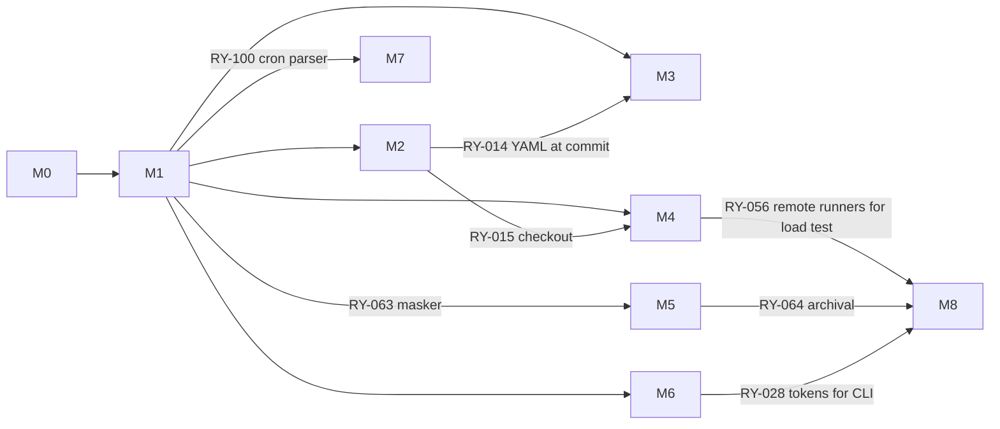

# Roadmap

Milestones group the tickets of the [backlog](backlog.md). Hours are engineering estimates including tests and documentation; a milestone is complete when every ticket is `done` and its exit criteria are verified on `main`. Overall progress: **200 of 2052 hours (9.7%)**.

## Overview

| Milestone | Theme                                          | Tickets | Hours done / total | Progress | Status  |
| --------- | ---------------------------------------------- | ------: | -----------------: | -------: | ------- |
| M0        | Foundation                                     |       6 |            22 / 22 |     100% | done    |
| M1        | First vertical slice: plan, run, lease, stream |      31 |          178 / 178 |     100% | done    |
| M2        | Repositories and push triggers                 |       7 |            0 / 134 |       0% | pending |
| M3        | Pipeline authoring and run control             |      12 |            0 / 225 |       0% | pending |
| M4        | Runner fleet, isolation and fair scheduling    |      11 |            0 / 345 |       0% | pending |
| M5        | Secrets, artifacts, caches and logs at scale   |      17 |            0 / 354 |       0% | pending |
| M6        | Teams, environments and approvals              |      13 |            0 / 218 |       0% | pending |
| M7        | Schedules, metrics and notifications           |      14 |            0 / 255 |       0% | pending |
| M8        | Production readiness                           |      13 |            0 / 321 |       0% | pending |
| **Total** |                                                | **124** |     **200 / 2052** | **9.7%** |         |

```mermaid
gantt
  title Railyard milestones (relative effort, 1 day = 6 engineering hours)
  dateFormat  X
  axisFormat %s
  section Done
  M0 Foundation              :done, m0, 0, 4
  M1 First vertical slice    :done, m1, after m0, 30
  section Pending
  M2 Repositories & triggers :m2, after m1, 22
  M3 Authoring & run control :m3, after m2, 38
  M4 Runner fleet            :m4, after m3, 58
  M5 Secrets/artifacts/logs  :m5, after m4, 59
  M6 Teams & approvals       :m6, after m5, 36
  M7 Schedules & metrics     :m7, after m6, 43
  M8 Production readiness    :m8, after m7, 54
```

## Dependency flow between milestones

---

## M0 Foundation — done (22 / 22 h)

**Goal:** a repository that builds, tests, migrates and serves health checks, with the full planned API surface visible as 501 stubs.

| Ticket | Title                                                                    | Hours | Status |
| ------ | ------------------------------------------------------------------------ | ----: | ------ |
| RY-001 | Monorepo tooling: workspaces, strict TS, ESLint, Prettier, CI workflow   |     6 | done   |
| RY-002 | Config loader (zod env), pino logging, request IDs, error envelope       |     5 | done   |
| RY-003 | Forward-only SQL migration runner with checksums                         |     5 | done   |
| RY-004 | Health and readiness endpoints                                           |     1 | done   |
| RY-005 | run.sh launcher (prereqs, .env bootstrap, db create, migrate, seed, dev) |     3 | done   |
| RY-007 | Pending-route registry returning 501 with ticket reference               |     2 | done   |

**Exit criteria (met)**

- `npm run lint && npm run format:check && npm run typecheck && npm test && npm run build` green in CI against a native PostgreSQL service started with systemctl (no containers).
- `./run.sh setup` works on a fresh clone against a local Postgres socket.
- `GET /api/ready` returns 503 when the database is down; every pending route answers 501 with its ticket.

## M1 First vertical slice — done (178 / 178 h)

**Goal:** prove the hardest core end to end: validate and plan a pipeline in `packages/shared`, persist a run, have runners lease and execute jobs with correct dependency semantics, and watch logs live in the browser.

| Ticket | Title                                                                                                | Hours | Status |
| ------ | ---------------------------------------------------------------------------------------------------- | ----: | ------ |
| RY-006 | Seed script with demo organization, project and runs                                                 |     3 | done   |
| RY-008 | Playwright end-to-end harness and smoke spec                                                         |     2 | done   |
| RY-010 | Projects: create, list, get (organization scoped)                                                    |     4 | done   |
| RY-020 | Register organization owner, login, logout, me; scrypt hashes; Postgres sessions                     |     8 | done   |
| RY-021 | CSRF token; login throttling (per-IP limit + per-email progressive backoff); registration rate limit |     4 | done   |
| RY-022 | RBAC roles and permission checks                                                                     |     3 | done   |
| RY-023 | Audit log write path                                                                                 |     2 | done   |
| RY-030 | YAML loader with line/column mapping                                                                 |     4 | done   |
| RY-031 | In-house pipeline schema validator with path-addressed issues                                        |    14 | done   |
| RY-032 | Expression language for if conditions and interpolation                                              |     8 | done   |
| RY-033 | Matrix expansion with include/exclude and limits                                                     |     6 | done   |
| RY-034 | DAG builder: cycle detection, topological levels, critical path                                      |     8 | done   |
| RY-035 | Execution planner: implicit stage needs, cascade exclusion, interpolation                            |     8 | done   |
| RY-036 | Pipeline validate API and editor screen with inline issues                                           |     5 | done   |
| RY-040 | Run creation: persist plan as jobs and steps in one transaction                                      |     8 | done   |
| RY-041 | Dependency promotion on completion (on_success / on_failure / always)                                |     6 | done   |
| RY-042 | Run status derivation, run list and run detail API                                                   |     5 | done   |
| RY-045 | Automatic retries (immediate requeue up to retries)                                                  |     3 | done   |
| RY-050 | Job leasing with FOR UPDATE SKIP LOCKED                                                              |     6 | done   |
| RY-051 | Lease heartbeats and reaper for expired leases                                                       |     6 | done   |
| RY-052 | Shell step execution in isolated workspaces with timeouts and process-group kill                     |    10 | done   |
| RY-060 | Log persistence in sequenced chunks                                                                  |     5 | done   |
| RY-061 | SSE live log streaming via LISTEN/NOTIFY with Last-Event-ID resume                                   |     8 | done   |
| RY-062 | ANSI rendering in the log viewer                                                                     |     5 | done   |
| RY-063 | Streaming secret masker (chunk-boundary safe)                                                        |     4 | done   |
| RY-100 | In-house cron parser with next-run computation (UTC)                                                 |     6 | done   |
| RY-120 | Web shell: login, layout, navigation with Planned badges                                             |     6 | done   |
| RY-121 | Projects screen (list and create)                                                                    |     4 | done   |
| RY-122 | Run graph view (DAG columns by level, SVG edges)                                                     |     8 | done   |
| RY-123 | Live log viewer with ANSI colours over SSE                                                           |     6 | done   |
| RY-125 | Run list per project                                                                                 |     3 | done   |

**Exit criteria (met)**

- Validator, expression, matrix, DAG, planner, cron, state machine, ANSI and masker covered by unit and property tests (shared coverage thresholds 85% lines, 80% branches).
- Concurrent leasing test proves no double-claim; reaper test proves expired leases follow the retry policy; executor test proves process-group kill on timeout.
- A demo run executes a matrix DAG through the runner, honours `on_failure` / `always` / `allow-failure` / `continue-on-error`, and its logs stream over SSE with ANSI colours in the Run page.
- Register, login throttling, CSRF and RBAC covered by HTTP integration tests.

## M2 Repositories and push triggers — pending (0 / 134 h)

**Goal:** runs start by themselves when commits land in local bare repositories, using the YAML stored at that commit.

| Ticket | Title                                                              | Hours | Status  |
| ------ | ------------------------------------------------------------------ | ----: | ------- |
| RY-011 | Projects: update, archive, delete with cascade rules               |     8 | pending |
| RY-012 | Git poller for local bare repositories (for-each-ref diffing)      |    30 | pending |
| RY-013 | Branch and commit browsing API                                     |    15 | pending |
| RY-014 | Load .railyard.yml from repository at a commit (git show)          |    18 | pending |
| RY-015 | Workspace checkout into job directory (git worktree / local clone) |    24 | pending |
| RY-016 | Push trigger matching with branch globs and automatic runs         |    15 | pending |
| RY-017 | Path filters: trigger runs only when matching paths change         |    24 | pending |

**Exit criteria**

- Pushing to a matching branch of a bare repository creates exactly one run within one poll interval (default 10 s); force-pushes and branch deletions are handled without duplicate runs.
- Jobs execute against a checkout of the run's SHA; checkout failures are reported as system log lines.
- Path filters evaluated on the old..new diff with tests for renames and merge commits.
- Git commands are invoked with argument arrays (no shell) and repository paths validated as absolute.

## M3 Pipeline authoring and run control — pending (0 / 225 h)

**Goal:** larger pipelines are pleasant to write and runs are controllable after they start.

| Ticket | Title                                                                  | Hours | Status  |
| ------ | ---------------------------------------------------------------------- | ----: | ------- |
| RY-018 | Pipeline definition history and diff view                              |    24 | pending |
| RY-019 | Multiple pipelines per project                                         |    18 | pending |
| RY-037 | Reusable templates: extends, includes, YAML anchors policy             |    36 | pending |
| RY-038 | Matrix-aware needs (depend on specific instances)                      |    15 | pending |
| RY-039 | JSON Schema export for editor autocompletion                           |    12 | pending |
| RY-043 | Cancel run or job (runner signalling, cascade)                         |    24 | pending |
| RY-044 | Retry failed job and re-run pipeline                                   |    18 | pending |
| RY-046 | Retry backoff and retryable exit codes                                 |     9 | pending |
| RY-047 | Run metadata: commit message, author, trigger actor                    |     9 | pending |
| RY-048 | Run-level timeouts and global queue limits                             |    12 | pending |
| RY-049 | Downstream pipeline triggers across projects                           |    36 | pending |
| RY-149 | Planner performance budget and benchmarks (1000-job plans under 50 ms) |    12 | pending |

**Exit criteria**

- Cancelling a running job terminates its process group within the kill grace period and cascades per `when` rules; cancel endpoints stop returning 501.
- Template expansion is validated with path-addressed issues pointing at the including file; include depth and total expanded size are bounded.
- Planner benchmark in CI: 1000-job plan p95 under 50 ms.
- Downstream triggers cannot form cross-project cycles (detected at trigger time).

## M4 Runner fleet, isolation and fair scheduling — pending (0 / 345 h)

**Goal:** many runners on many hosts, matched by labels, contained by resource limits, sharing capacity fairly.

| Ticket | Title                                                        | Hours | Status  |
| ------ | ------------------------------------------------------------ | ----: | ------- |
| RY-053 | Runner registration tokens and runs-on label matching        |    30 | pending |
| RY-054 | Resource limits (rlimits, cgroups v2 via systemd-run)        |    36 | pending |
| RY-055 | Graceful runner shutdown and drain                           |    12 | pending |
| RY-056 | Remote runners over HTTPS long-polling (no direct DB access) |    60 | pending |
| RY-057 | Workspace cleanup and disk quotas                            |    12 | pending |
| RY-058 | Unprivileged sandboxing with user namespaces (no containers) |    60 | pending |
| RY-059 | Local runner process pool autoscaling                        |    36 | pending |
| RY-095 | Concurrency groups (queue or cancel-in-progress)             |    24 | pending |
| RY-096 | Per-project parallelism limits and matrix max-parallel       |    15 | pending |
| RY-097 | Fair-share scheduling across projects (weighted queues)      |    36 | pending |
| RY-098 | Job priorities and preemption of low-priority work           |    24 | pending |

**Exit criteria**

- Remote runner completes jobs with only an HTTPS URL and a runner token; database credentials never leave the server.
- Label matching, concurrency groups, parallelism limits and fair share all enforced inside the lease transaction; concurrent tests show no limit overshoot.
- A step exceeding its memory limit fails with a clear reason; sandboxed steps cannot write outside the workspace.
- Runner refuses leases below the free-disk floor; SIGTERM drains within the configured timeout.

## M5 Secrets, artifacts, caches and logs at scale — pending (0 / 354 h)

**Goal:** real pipelines can use credentials, keep outputs, reuse caches, and logs stay fast and affordable.

| Ticket | Title                                                                  | Hours | Status  |
| ------ | ---------------------------------------------------------------------- | ----: | ------- |
| RY-064 | Log archival to compressed files and retention                         |    24 | pending |
| RY-065 | Log search and raw download                                            |    15 | pending |
| RY-066 | Log fan-out at scale: shared LISTEN connection, backpressure, batching |    24 | pending |
| RY-067 | JUnit XML test report parsing and annotations                          |    36 | pending |
| RY-068 | Collapsible log groups and step annotations                            |    18 | pending |
| RY-070 | AES-256-GCM secret store with key versioning                           |    24 | pending |
| RY-071 | Secret CRUD API and UI (write-only values)                             |    15 | pending |
| RY-072 | Secret injection into job environment with log masking                 |    12 | pending |
| RY-073 | Master key rotation tooling                                            |    15 | pending |
| RY-074 | Secret scopes (organization / project / environment) and access audit  |    18 | pending |
| RY-080 | Artifact upload from workspace to local artifact store                 |    30 | pending |
| RY-081 | Artifact browse and download API and UI                                |    15 | pending |
| RY-082 | Artifact retention and expiry sweeper                                  |    12 | pending |
| RY-083 | Cache save/restore keyed by interpolated templates                     |    30 | pending |
| RY-084 | Cache eviction (LRU, per-project quota)                                |    12 | pending |
| RY-085 | Artifact passing between dependent jobs                                |    24 | pending |
| RY-086 | Content-addressed artifact storage with deduplication                  |    30 | pending |

**Exit criteria**

- Secret values never appear in API responses, application logs or job logs (property test plus end-to-end test printing secrets in split chunks).
- Master key rotation completes without downtime; both key versions decrypt mid-rotation.
- Artifact paths cannot escape the workspace (symlink and `..` tests); expired artifacts are swept.
- 500 concurrent SSE viewers per API node with bounded memory; archived logs readable through the same endpoints.
- `not_yet_executed` warnings for `cache` and `artifacts` removed from the validator.

## M6 Teams, environments and approvals — pending (0 / 218 h)

**Goal:** multi-person organizations with controlled production deployments.

| Ticket | Title                                                                           | Hours | Status  |
| ------ | ------------------------------------------------------------------------------- | ----: | ------- |
| RY-024 | Member invitations via local outbox                                             |    18 | pending |
| RY-025 | Member management and role changes                                              |    12 | pending |
| RY-026 | Audit log query API and UI                                                      |    15 | pending |
| RY-027 | Password reset through outbox tokens                                            |    12 | pending |
| RY-028 | Personal API tokens for CLI and automation                                      |    15 | pending |
| RY-029 | Session listing and revocation                                                  |     8 | pending |
| RY-090 | Deployment environments and deployment history                                  |    24 | pending |
| RY-091 | Manual approval gates with required reviewers                                   |    30 | pending |
| RY-092 | Environment protection rules (branch restrictions)                              |    12 | pending |
| RY-093 | Deployment rollback action                                                      |    18 | pending |
| RY-126 | Settings screens: organization, members, tokens                                 |    24 | pending |
| RY-150 | Email-verified signup through the local outbox (enumeration-safe 202 responses) |    18 | pending |
| RY-151 | Postgres-backed shared rate-limit counters for multi-instance deployments       |    12 | pending |

**Exit criteria**

- Approvals cannot be granted by the requester; every approval, rejection and role change is audited and queryable.
- Signup, password reset and invitation endpoints return indistinguishable responses for existing and unknown emails.
- Two API processes enforce identical login throttling.
- Settings section loses its "Planned" badge.

## M7 Schedules, metrics and notifications — pending (0 / 255 h)

**Goal:** time-based pipelines and the feedback loops that tell teams how their CI behaves.

| Ticket | Title                                                                     | Hours | Status  |
| ------ | ------------------------------------------------------------------------- | ----: | ------- |
| RY-101 | Schedule CRUD API                                                         |    12 | pending |
| RY-102 | Scheduler daemon with advisory-lock leader election and missed-run policy |    30 | pending |
| RY-103 | IANA time zone support for schedules (DST-safe)                           |    24 | pending |
| RY-104 | Schedule pause/resume and trigger history                                 |     9 | pending |
| RY-110 | Queue time and duration percentile metrics API                            |    24 | pending |
| RY-111 | Metrics dashboard UI with SVG charts                                      |    24 | pending |
| RY-112 | Prometheus text-format /metrics endpoint                                  |     9 | pending |
| RY-113 | Flaky job detection from retry history                                    |    24 | pending |
| RY-114 | Trace export (OTLP-compatible JSON files) for run timelines               |    24 | pending |
| RY-115 | Queue-time SLO alerts (in-app)                                            |    18 | pending |
| RY-130 | In-app notifications for run failures                                     |    18 | pending |
| RY-131 | Outbox email notifications (file sink, no external provider)              |    15 | pending |
| RY-132 | SVG status badges per project and branch                                  |     9 | pending |
| RY-133 | Commit status write-back as git notes in the bare repository              |    15 | pending |

**Exit criteria**

- With two scheduler processes, each slot fires exactly once (unique slot record); DST transition tests for spring-forward and fall-back pass for at least three zones.
- Percentiles match a reference computation on fixture data; `/metrics` parses with the Prometheus text format rules.
- Notifications never call an external provider; outbox files are the only email sink.

## M8 Production readiness — pending (0 / 321 h)

**Goal:** a 1.0 that operators can install, upgrade, back up, scale and trust.

| Ticket | Title                                                            | Hours | Status  |
| ------ | ---------------------------------------------------------------- | ----: | ------- |
| RY-009 | Release packaging: tarball build, systemd units, nginx sample    |    15 | pending |
| RY-127 | Accessibility audit and keyboard navigation                      |    15 | pending |
| RY-128 | Responsive layout and dark theme                                 |     9 | pending |
| RY-129 | Visual pipeline editor (graph-based authoring)                   |    60 | pending |
| RY-140 | Backup and restore tooling                                       |     9 | pending |
| RY-141 | Load test: 10k queued jobs, 50 runners                           |    24 | pending |
| RY-142 | Security hardening review against ASVS L2                        |    24 | pending |
| RY-143 | Data retention jobs for runs and logs                            |    15 | pending |
| RY-144 | High availability: multiple API nodes and LISTEN/NOTIFY failover |    36 | pending |
| RY-145 | Upgrade and migration rollback playbooks                         |    12 | pending |
| RY-146 | Multi-organization operator console                              |    30 | pending |
| RY-147 | Command-line client (validate, run, logs)                        |    48 | pending |
| RY-148 | User guide and tutorials                                         |    24 | pending |

**Exit criteria**

- Load test: 10k queued jobs, 50 runners, lease p99 under 50 ms, zero double-leases, zero log gaps.
- HA drill: killing one of two API nodes keeps SSE clients resuming within 5 s.
- Backup and restore drill on a clean VM documented with measured RTO.
- ASVS L2 review with no open high findings; WCAG 2.1 AA on core screens.
- Release tarball installs with systemd and nginx only; no container runtime anywhere in the docs or tooling.
