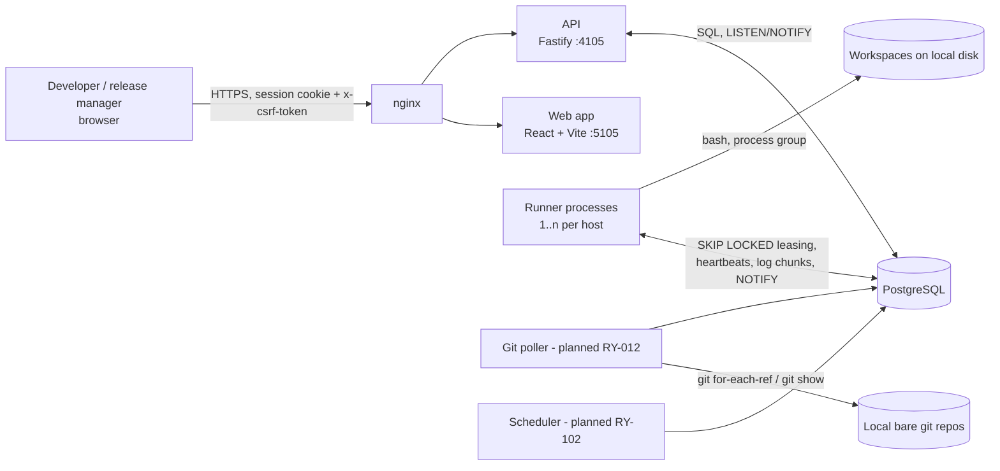

# Railyard Product Requirements Document

| Field                   | Value                                                                                                                                                                                                                                                                 |
| ----------------------- | --------------------------------------------------------------------------------------------------------------------------------------------------------------------------------------------------------------------------------------------------------------------- |
| Product                 | Railyard, a self-hosted CI/CD pipeline orchestrator                                                                                                                                                                                                                   |
| Document owner          | Product / tech lead                                                                                                                                                                                                                                                   |
| Status                  | Living document; reflects backlog state of `main`                                                                                                                                                                                                                     |
| Implementation progress | 200 of 2052 estimated hours done (9.7%), milestones M0 and M1 complete                                                                                                                                                                                                |
| Related                 | [requirements.md](requirements.md), [user-stories.md](user-stories.md), [requirements-traceability.md](requirements-traceability.md), [roadmap](../planning/roadmap.md), [backlog](../planning/backlog.md), [risks](../planning/risks.md), [glossary](../glossary.md) |

## 1. Vision

Give small and mid-sized engineering teams a CI/CD system they can run on a single Linux VM with nothing but Node.js and PostgreSQL: pipelines described in a reviewed YAML file next to the code, executed as a dependency graph by runner processes that coordinate through Postgres row locks, with live logs, retries, approvals and schedules. No hosted control plane, no container daemon, no third-party API on the critical path. If the network to the outside world disappears, builds keep running.

## 2. Problem statement

| Observed problem                                                                                           | Who feels it                          | Consequence today                                                                                |
| ---------------------------------------------------------------------------------------------------------- | ------------------------------------- | ------------------------------------------------------------------------------------------------ |
| Hosted CI services require code and secrets to leave the network, and bill per minute                      | Security reviewers, small-team owners | Air-gapped or regulated teams cannot use them; costs scale unpredictably with matrix builds      |
| Self-hosted alternatives assume a container runtime, an object store, a message broker and a git forge API | Platform engineers                    | Operating the CI system becomes a project of its own (5+ services to patch, back up and monitor) |
| Pipelines expressed as stages only serialise work that could run in parallel                               | Application developers                | Wall-clock time is dominated by the slowest job of each stage, not by the true critical path     |
| Pipeline files fail at run time on typos, unknown job names or cycles                                      | Application developers                | Feedback arrives minutes later, after runner capacity has been consumed                          |
| Logs are delivered in batches or only after a job finishes, and leak secrets printed by tools              | Developers, security reviewers        | Slow debugging; credentials in logs are a recurring incident class                               |
| Crashed build hosts leave jobs "running" forever                                                           | Release managers                      | Releases blocked until someone manually cleans up state                                          |

## 3. Personas

| Persona                                   | Context                                                           | Goals                                                                                                                  | Pain points                                                           | Primary features                                                                                    |
| ----------------------------------------- | ----------------------------------------------------------------- | ---------------------------------------------------------------------------------------------------------------------- | --------------------------------------------------------------------- | --------------------------------------------------------------------------------------------------- |
| **Priya, platform engineer**              | Runs internal infrastructure for 40 engineers on a handful of VMs | One system to install with systemd, predictable resource use, runners she can add without touching the database schema | Container sprawl, brittle broker setups, runaway builds filling disks | Runners and leasing (E6), concurrency and fair share (E11), operations tooling (E15), metrics (E13) |
| **Marco, application developer**          | Ships a TypeScript service several times a day                    | Fast feedback, pipelines that express real dependencies, readable live logs                                            | Waiting on stage barriers, cryptic YAML errors, ANSI garbage in logs  | Pipeline validation and planning (E4), run graph and live logs (E5, E7, E14), retries               |
| **Dana, release manager**                 | Coordinates production deploys for three teams                    | Know exactly what is deployed where, gate production behind approvals, roll back quickly                               | No audit of who approved what; stuck runs after host failures         | Environments and approvals (E10), cancellation and re-run (E5), audit log (E2)                      |
| **Sam, security and compliance reviewer** | Signs off on tooling handling credentials                         | Secrets encrypted at rest, never echoed in logs, least-privilege roles, a reviewable audit trail                       | Plaintext secrets in CI variables; broad admin roles                  | Secrets with masking (E8), RBAC and audit (E2), threat model and ASVS hardening (E15)               |
| **Lee, small-team owner**                 | Four-person startup on a single rented server                     | Install in under 15 minutes, no monthly bill, sane defaults                                                            | Operating cost and complexity of enterprise CI                        | `run.sh` setup, seed demo, single-process deployment, notifications and badges (E16)                |

## 4. Goals

| ID  | Goal                                                                        | Measured by                                                                                                                                                                           |
| --- | --------------------------------------------------------------------------- | ------------------------------------------------------------------------------------------------------------------------------------------------------------------------------------- |
| G1  | Catch pipeline definition errors before any runner capacity is used         | Share of runs failing for definition reasons after validation passes (target 0%; every structural error is reported by `POST /api/pipelines/validate` with path, line and column)     |
| G2  | Execute pipelines as a true DAG so wall-clock time tracks the critical path | Plan exposes `levels` and `criticalPath`; median run duration within 10% of critical-path job durations sum on the demo pipelines                                                     |
| G3  | Never lose or double-execute a job, even when runners crash                 | Zero double-leases in concurrent leasing tests; lost leases recovered within lease TTL + reaper interval (default 30 s + 10 s)                                                        |
| G4  | Live, ordered, resumable, secret-free logs                                  | Log chunk to browser latency p95 under 1 s on a single node; zero gaps or duplicates across SSE reconnects; zero unmasked secret occurrences in a property test of arbitrary chunking |
| G5  | Operate with Node.js and PostgreSQL only                                    | Production deployment consists of systemd units, an nginx site and a Postgres database; no container runtime, broker or object store                                                  |
| G6  | Least privilege and auditability by default                                 | Every mutating endpoint guarded by a named permission; every run creation and auth event written to `audit_logs`                                                                      |

## 5. Non-goals

| Non-goal                                                                                                  | Rationale                                                                                                                                                                              |
| --------------------------------------------------------------------------------------------------------- | -------------------------------------------------------------------------------------------------------------------------------------------------------------------------------------- |
| Docker, OCI images or any container runtime for builds, development, CI or deployment                     | Core product promise is "Node.js + PostgreSQL only". Isolation is provided by process groups, rlimits, cgroups v2 via `systemd-run` (RY-054) and unprivileged user namespaces (RY-058) |
| Integration with GitHub, GitLab, Bitbucket or any forge API, webhooks from hosted services                | Repositories are **local bare git repositories** that Railyard polls with `git for-each-ref` (RY-012). Commit status is written back as git notes (RY-133)                             |
| Any third-party API or hosted service at runtime (email providers, object stores, OAuth, analytics, CDNs) | Email goes to a local outbox file sink (RY-131), artifacts and caches live on local disk (E9), authentication is first-party                                                           |
| Hosted multi-tenant SaaS offering                                                                         | Organization scoping exists for isolation inside one installation and for the operator console (RY-146), not for a public service                                                      |
| Windows and macOS runners                                                                                 | Runner semantics rely on POSIX process groups, `bash` and Linux cgroups                                                                                                                |
| A general-purpose workflow engine (human tasks, long-lived sagas)                                         | Scope is build, test and deploy pipelines with bounded duration (job timeout max 24 h)                                                                                                 |
| Marketplace of reusable actions                                                                           | Reuse is through `extends`/`includes` templates inside the installation (RY-037)                                                                                                       |

## 6. Scope

### 6.1 Delivered (M0 and M1)

| Area                                | What exists                                                                                                                                                                                                                                                                                                                                                                    | Tickets                |
| ----------------------------------- | ------------------------------------------------------------------------------------------------------------------------------------------------------------------------------------------------------------------------------------------------------------------------------------------------------------------------------------------------------------------------------ | ---------------------- |
| Foundation                          | npm workspaces, strict TypeScript, ESLint/Prettier, CI workflow, zod-validated config, pino logs with request IDs, JSON error envelope, forward-only checksummed migrations, health/readiness, `run.sh`, seed data, 501 registry for planned routes, Playwright harness                                                                                                        | RY-001..RY-008         |
| Identity                            | Register organization owner, login/logout/me, scrypt hashes, Postgres sessions with HMAC'd ids, CSRF header `x-csrf-token`, login throttling per IP plus per-email progressive backoff and a per-IP cap on distinct emails (IPv6 keyed by /64), registration rate limit per IP with a generic non-enumerating error, RBAC roles owner/admin/developer/viewer, audit write path | RY-020..RY-023         |
| Pipeline engine (`packages/shared`) | YAML loader with positions, in-house schema validator (path-addressed issues, hard limits), expression language (`if:` and `${{ }}`), matrix expansion with include/exclude, DAG cycle detection, topological levels and critical path, deterministic execution planner, cron parser                                                                                           | RY-030..RY-035, RY-100 |
| Orchestration                       | Transactional run creation, dependency promotion honouring `when`, run status derivation, cursor-paginated run list, automatic retries                                                                                                                                                                                                                                         | RY-040..RY-042, RY-045 |
| Runner                              | `FOR UPDATE SKIP LOCKED` leasing, lease heartbeats, reaper, shell steps in per-attempt workspaces with timeouts and process-group kill, scrubbed environment                                                                                                                                                                                                                   | RY-050..RY-052         |
| Logs                                | Sequenced chunk persistence with a 5 MiB per-attempt cap, SSE streaming through a LISTEN/NOTIFY hub with `Last-Event-ID` resume, ANSI parser, chunk-boundary-safe secret masker                                                                                                                                                                                                | RY-060..RY-063         |
| Web (port 5105, API on 4105)        | Login and Register screens, app shell with navigation where Secrets, Environments, Schedules, Runners, Artifacts, Metrics and Settings show a "Planned" badge, Projects list/create, project Runs list, Run detail with DAG graph (columns by level, SVG edges) and live log viewer (SSE + ANSI colours), Pipeline editor that validates YAML and previews the plan            | RY-036, RY-120..RY-125 |

### 6.2 Planned (M2 to M8)

Git polling and push triggers, templates, cancellation and re-run, remote and sandboxed runners, concurrency groups and fair share, secrets, artifacts and caches, log archival, environments and approvals, member management and API tokens, schedules, metrics, notifications, packaging, HA and a command-line client. Every planned HTTP endpoint is already registered and answers `501 NOT_IMPLEMENTED` with its ticket id (see `apps/api/src/modules/pending/pending.routes.ts`). Pipeline keys whose execution is not yet built (`cache`, `artifacts`, `environment`, `concurrency`) are validated and produce a `not_yet_executed` warning naming the ticket.

### 6.3 System context

## 7. Success metrics

| Metric                   | Target                                                                                                                                | Measurement source                                                                     | Milestone                        |
| ------------------------ | ------------------------------------------------------------------------------------------------------------------------------------- | -------------------------------------------------------------------------------------- | -------------------------------- |
| Validation coverage      | 100% of validator issue codes covered by tests; every error carries a JSON path, and a line/column when the node exists in the source | `packages/shared/test/validate.test.ts`                                                | M1 (met)                         |
| Double-lease rate        | 0 in N concurrent claimers over the same queue                                                                                        | `apps/api/test/runner.db.test.ts` "never hands the same job to two concurrent runners" | M1 (met)                         |
| Lost-lease recovery time | at most `RUNNER_LEASE_SECONDS` + 10 s reaper interval (40 s default)                                                                  | Reaper test plus runner metrics                                                        | M1 (met), reported in M7 metrics |
| Log stream integrity     | 0 gaps, 0 duplicates across reconnects with `Last-Event-ID`                                                                           | SSE integration test, load test RY-141                                                 | M1 / M8                          |
| Secret masking           | 0 secret occurrences across every chunking of a stream                                                                                | Property test in `packages/shared/test/logs.test.ts`                                   | M1 (met), extended by RY-072     |
| Planner performance      | 1000-job plan compiled in under 50 ms p95                                                                                             | Benchmark RY-149                                                                       | M3                               |
| Queue latency            | p95 queued-to-running under 2 s with idle capacity; p99 lease query under 50 ms with 10k queued jobs and 50 runners                   | Metrics API RY-110, load test RY-141                                                   | M7 / M8                          |
| Time to first green run  | under 15 minutes from fresh clone with `./run.sh setup`                                                                               | Scripted check in release checklist                                                    | M8                               |
| Test coverage            | at least 80% statements on implemented paths                                                                                          | `npm run test:coverage` thresholds                                                     | every milestone                  |
| Security posture         | ASVS L2 checklist with no open high findings                                                                                          | RY-142 review                                                                          | M8                               |
| Accessibility            | WCAG 2.1 AA on run detail, log viewer and editor                                                                                      | RY-127 audit                                                                           | M8                               |

## 8. Release plan

Releases are cut per milestone from `main` as a versioned tarball (systemd units and nginx sample arrive with RY-009). Hours are engineering estimates including tests and docs.

| Release | Milestone | Theme                                     | Hours (done/total) | User-visible outcome                                                                                | Status  |
| ------- | --------- | ----------------------------------------- | -----------------: | --------------------------------------------------------------------------------------------------- | ------- |
| 0.0.x   | M0        | Foundation                                |              22/22 | Repo boots, migrates, answers health and 501 for planned routes                                     | done    |
| 0.1.0   | M1        | First vertical slice                      |            178/178 | Validate a pipeline, create a run, watch runners execute the DAG with live logs                     | done    |
| 0.2.0   | M2        | Repositories and triggers                 |              0/134 | Pushes to a local bare repo start runs automatically, with branch globs and path filters            | pending |
| 0.3.0   | M3        | Pipeline authoring and run control        |              0/225 | Templates, matrix-aware needs, cancel, retry, re-run, downstream triggers                           | pending |
| 0.4.0   | M4        | Runner fleet and scheduling fairness      |              0/345 | Remote runners over HTTPS, labels, resource limits, sandboxing, concurrency groups, fair share      | pending |
| 0.5.0   | M5        | Secrets, artifacts, caches, logs at scale |              0/354 | Encrypted secrets injected and masked, artifacts and caches, log archival and search                | pending |
| 0.6.0   | M6        | Teams, environments, approvals            |              0/218 | Invitations, roles, API tokens, deployment environments with approval gates and rollback            | pending |
| 0.7.0   | M7        | Schedules, metrics, notifications         |              0/255 | Cron schedules with time zones, metrics dashboard and Prometheus endpoint, notifications and badges | pending |
| 1.0.0   | M8        | Production readiness                      |              0/321 | Packaging, backup/restore, HA, ASVS L2 hardening, accessibility, CLI, user guide                    | pending |

## 9. Assumptions and constraints

| Type       | Statement                                                                                                                                     |
| ---------- | --------------------------------------------------------------------------------------------------------------------------------------------- |
| Constraint | Node.js 22+, PostgreSQL 15+, Linux runner hosts with `bash` and `git` installed                                                               |
| Constraint | No outbound network calls from Railyard itself; pipeline steps may use the network only if the host allows it                                 |
| Constraint | Until RY-151 ships, rate limiters are in-process, so exactly one API process may serve traffic                                                |
| Assumption | Pipeline YAML is authored by trusted organization members but treated as untrusted input by the validator (size, depth, key and limit checks) |
| Assumption | Build hosts are dedicated to Railyard; until RY-054/RY-058, steps run as the runner's OS user                                                 |

## 10. Open questions

| Question                                                                           | Owner             | Decide by        |
| ---------------------------------------------------------------------------------- | ----------------- | ---------------- |
| Should remote runners (RY-056) receive secrets per job or per step?                | Security reviewer | Before M5 starts |
| Default missed-run policy for schedules after downtime: run once, run all, or skip | Product           | M7 planning      |
| Archive format for logs (gzip per job vs per attempt) and retention defaults       | Platform engineer | M5 planning      |
