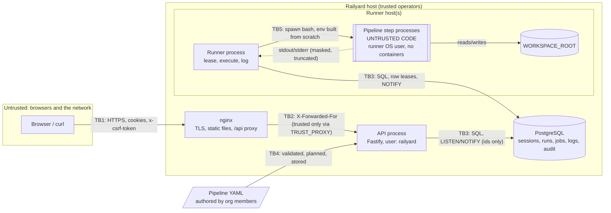

# Threat model

Scope: Railyard 0.1 as built on `main` (API, runner, web UI, PostgreSQL) deployed on one host or a small set of VMs as described in [deployment.md](../operations/deployment.md). Planned features are covered where they change the picture, always with their backlog ticket. Method: STRIDE per component, then mitigations, residual risks and an OWASP ASVS 4.0.3 mapping. Review this document whenever a ticket in E2 Identity & Access, E6 Runner & Execution or E8 Secrets lands.

## 1. System summary

| Component        | Code                                 | Runs as                                          | Talks to                                           |
| ---------------- | ------------------------------------ | ------------------------------------------------ | -------------------------------------------------- |
| Web UI           | `apps/web` (React SPA, static files) | browser                                          | API over same-origin HTTPS via nginx               |
| Reverse proxy    | nginx                                | `www-data`                                       | API on `127.0.0.1:4105`                            |
| API              | `apps/api/src/index.ts` (Fastify 5)  | `railyard` OS user                               | PostgreSQL (pool + one LISTEN connection)          |
| Runner           | `apps/api/src/runner/cli.ts`         | `railyard-runner` OS user (recommended; see 6.1) | PostgreSQL directly; local shell; `WORKSPACE_ROOT` |
| Database         | PostgreSQL 15+                       | `postgres`                                       | API and runners over a local socket or TLS         |
| Pipeline scripts | `steps[].run` in user YAML           | the runner's OS user                             | whatever the host network allows                   |

## 2. Assets

| Asset                      | Where                                                                           | Why it matters                                                                                  |
| -------------------------- | ------------------------------------------------------------------------------- | ----------------------------------------------------------------------------------------------- |
| User credentials           | `users.password_hash` (scrypt N=16384, r=8, p=1, 16-byte salt, 64-byte key)     | account takeover across the organization                                                        |
| Session tokens             | browser cookie `ry_session`; `sessions.id` = HMAC-SHA256(SESSION_SECRET, token) | full impersonation for up to `SESSION_TTL_HOURS`                                                |
| `SESSION_SECRET`           | API and runner environment (`.env` / systemd `EnvironmentFile`)                 | with a DB dump, lets an attacker compute session ids from tokens; rotating it logs everyone out |
| `DATABASE_URL` credentials | API and runner environment                                                      | direct read/write of every tenant's data, bypassing all API checks                              |
| Pipeline definitions       | `pipeline_runs.source_yaml`, `job_steps.script`                                 | define code that will execute on runner hosts                                                   |
| Job logs                   | `job_log_chunks`                                                                | may contain secrets printed by scripts, internal hostnames, stack traces                        |
| Workspaces                 | `WORKSPACE_ROOT/<runId>/<jobId>-a<attempt>`                                     | checked-out source and build outputs; cross-job data leakage                                    |
| Secrets (planned)          | `secrets` table, AES-256-GCM (RY-070..RY-073)                                   | deploy keys, registry tokens, cloud credentials                                                 |
| Audit trail                | `audit_logs`                                                                    | forensic record of logins, registrations, project and run creation                              |
| Runner hosts               | the machines that execute steps                                                 | lateral movement into the build network                                                         |
| Availability of the queue  | `jobs` (queued/running), runners                                                | delayed or blocked deployments                                                                  |

## 3. Trust boundaries

| ID  | Boundary                                   | Crossing data                       | Primary controls                                                                                                                 |
| --- | ------------------------------------------ | ----------------------------------- | -------------------------------------------------------------------------------------------------------------------------------- |
| TB1 | Browser to nginx                           | credentials, cookies, JSON, SSE     | TLS (nginx), HttpOnly + SameSite=Lax + Secure cookies, CSRF token bound to session, zod validation, 512 KiB body limit           |
| TB2 | nginx to API                               | proxied requests, `X-Forwarded-For` | API binds `127.0.0.1`; `TRUST_PROXY` set to the proxy address so `request.ip` cannot be spoofed                                  |
| TB3 | API/runner to Postgres                     | all persistent state                | parameterised SQL only; least-privilege DB role; local socket or `sslmode=verify-full`                                           |
| TB4 | Organization member to pipeline definition | YAML that becomes shell scripts     | in-house validator with hard limits; `run:create` permission; audit `run.created`                                                |
| TB5 | Runner to step process                     | script, env, cwd                    | fresh env (no runner secrets), per-attempt workspace, path-escape checks, process-group kill on timeout; **no OS isolation yet** |

TB5 is the most important boundary in the system and the weakest today. Anyone with `run:create` (owner, admin, developer) can execute arbitrary commands on every runner host as the runner's OS user.

## 4. STRIDE per component

Status column: **M** = mitigated in code today, **P** = partially mitigated, **R** = residual / planned (ticket).

### 4.1 Web UI and browser session

| STRIDE | Threat                                                    | Mitigation                                                                                                                                             | Status |
| ------ | --------------------------------------------------------- | ------------------------------------------------------------------------------------------------------------------------------------------------------ | ------ |
| S      | Session theft via XSS reading the cookie                  | `ry_session` is HttpOnly; React escapes output; log content rendered from parsed ANSI segments as text, never `innerHTML`                              | M      |
| S      | Login CSRF (forcing a victim into the attacker's account) | JSON-only login body; cross-site forms cannot produce a valid JSON object body and cross-site `fetch` with JSON needs a preflight the API never grants | P      |
| T      | Cross-site request forgery on mutations                   | SameSite=Lax cookies plus `x-csrf-token` that must equal the token stored with the session (not just the cookie); checked before permission            | M      |
| I      | Clickjacking of the UI or API responses                   | `x-frame-options: DENY` on API responses; nginx adds the same plus a CSP for static files (deployment.md)                                              | M      |
| I      | Sensitive responses cached by browsers or proxies         | `cache-control: no-store` on every API response                                                                                                        | M      |
| E      | Privilege escalation by editing role in the client        | role read from the server-side session join on every request; client role is display only                                                              | M      |

### 4.2 API: authentication and accounts

| STRIDE | Threat                                                                                                  | Mitigation                                                                                                                                                                                                                                                                                                                                                                                                                                           | Status             |
| ------ | ------------------------------------------------------------------------------------------------------- | ---------------------------------------------------------------------------------------------------------------------------------------------------------------------------------------------------------------------------------------------------------------------------------------------------------------------------------------------------------------------------------------------------------------------------------------------------- | ------------------ |
| S      | Password spraying (one source, many accounts)                                                           | per-IP fixed-window limiter on all login attempts: `LOGIN_IP_RATE_LIMIT` (50) per `LOGIN_RATE_WINDOW_SECONDS` (900)                                                                                                                                                                                                                                                                                                                                  | M                  |
| S      | Account cycling from one source (many emails, few attempts each, staying under the per-email backoff)   | distinct-emails-per-IP limiter: at most `LOGIN_MAX_EMAILS_PER_IP` (20) different emails per normalised IP per `LOGIN_RATE_WINDOW_SECONDS`                                                                                                                                                                                                                                                                                                            | M                  |
| S      | Credential stuffing (many sources, one account)                                                         | per-email progressive backoff: `LOGIN_EMAIL_FREE_ATTEMPTS` (5) free failures, then `LOGIN_BACKOFF_BASE_SECONDS` x 2^(n-1) up to `LOGIN_BACKOFF_MAX_SECONDS` (3600); keyed by normalised email so rotating IPs does not help. Each attempt is reserved synchronously before the first `await` (counted as a failure, reset on success), so a burst of parallel requests cannot all slip past the check while scrypt runs                              | M                  |
| S      | Spoofing or rotating the client IP to dodge per-IP limits                                               | `TRUST_PROXY` must be configured explicitly: `false` (default, socket address), a hop count, or a proxy IP/CIDR list; the literal `true` is rejected by `parseTrustProxy`, and with `NODE_ENV=production` start-up fails if `TRUST_PROXY` is unset. Limiter keys use the normalised IP (`client-ip.ts`): IPv4-mapped IPv6 becomes IPv4 and other IPv6 addresses collapse to their /64, so hopping within one subscriber prefix does not reset limits | M                  |
| S      | Offline cracking after a DB leak                                                                        | scrypt with per-user salt, minimum password length 12, max 256                                                                                                                                                                                                                                                                                                                                                                                       | M                  |
| S      | Session token replay from a DB dump                                                                     | only HMAC-SHA256(SESSION_SECRET, token) is stored; the raw token never touches the DB                                                                                                                                                                                                                                                                                                                                                                | M                  |
| S      | Session fixation                                                                                        | a new random token and CSRF token are minted on every login and registration                                                                                                                                                                                                                                                                                                                                                                         | M                  |
| I      | Account enumeration via login                                                                           | identical `401 INVALID_CREDENTIALS` for unknown users, wrong passwords and disabled users; scrypt always runs (against `DUMMY_HASH` for unknown users) to equalise timing                                                                                                                                                                                                                                                                            | M                  |
| I      | Account enumeration via registration                                                                    | registration rate-limited per IP (`REGISTER_RATE_LIMIT` 5 per `REGISTER_RATE_WINDOW_SECONDS` 3600, counted before validation); one generic `409 CONFLICT` message for both "email exists" and "slug taken", including the race-condition path (unique violation)                                                                                                                                                                                     | P, full fix RY-150 |
| D      | Exhausting CPU with scrypt via login floods                                                             | per-IP limiter checked before scrypt; per-email backoff checked before scrypt                                                                                                                                                                                                                                                                                                                                                                        | P                  |
| D      | Memory exhaustion of limiter stores with random keys, or evicting a victim's throttle state by flooding | every store is bounded by `RATE_LIMIT_MAX_KEYS` (10 000). When full it sweeps expired entries with a resumable cursor that eventually covers the whole map; if every entry is still active it evicts the entry with the least time left (the cheapest state to lose) and logs a warning. New keys are never locked out by a full store. The distinct-emails-per-IP cap limits how fast one client can create per-email keys                          | M                  |
| R      | Denying a login or registration happened                                                                | `auth.login`, `auth.login_failed` (with attempted email and IP), `auth.registered`, `auth.logout` audit rows with request id                                                                                                                                                                                                                                                                                                                         | M                  |
| E      | Disabled user keeps using a live session                                                                | `authenticate()` re-reads the user on every request and rejects `disabled_at` users                                                                                                                                                                                                                                                                                                                                                                  | M                  |

Limiter state is **in memory per API process**. Two API instances would double every budget and lose state on restart. These counters must move to Postgres (RY-151) before more than one API instance runs; until then [deployment.md](../operations/deployment.md) mandates a single API process. Restarting the API resets all counters, which an attacker cannot trigger remotely but an operator should be aware of during an incident.

Registration still leaks one bit: a `409` means "something about these details is taken". The generic message plus the per-IP limit makes harvesting slow (5 probes per hour per IP), but a distributed attacker can still test emails. RY-150 replaces it with email-verified signup through the local outbox that always answers `202 Accepted`, sending "you already have an account" mail to existing addresses instead.

### 4.3 API: authorization and tenant isolation

| STRIDE | Threat                                                                       | Mitigation                                                                                                                                                                                                                                | Status |
| ------ | ---------------------------------------------------------------------------- | ----------------------------------------------------------------------------------------------------------------------------------------------------------------------------------------------------------------------------------------- | ------ |
| I      | Reading another organization's projects, runs or logs by guessing ids (IDOR) | every repository function takes `organizationId` and adds `organization_id = $n` to the WHERE clause (`project.repository.ts`, `run.repository.ts`, `findJobInOrganization`); ids are random UUIDs; foreign resources answer 404, not 403 | M      |
| I      | Log stream for a foreign job                                                 | the job is looked up with run id **and** organization before the SSE stream opens                                                                                                                                                         | M      |
| E      | Viewer creating runs or projects                                             | `guard(permission)` on every route; `ROLE_PERMISSIONS` table in shared code; integration test "forbids viewers from creating projects"                                                                                                    | M      |
| E      | Pending endpoints as an unguarded side door                                  | pending routes use the same `guard(permission)` and CSRF check before returning 501                                                                                                                                                       | M      |
| T      | SQL injection                                                                | all queries parameterised; set-based inserts pass JSON as a single bound parameter to `jsonb_to_recordset`                                                                                                                                | M      |
| T      | Mass assignment                                                              | handlers pass only zod-parsed fields to repositories; unknown body fields are dropped                                                                                                                                                     | M      |

### 4.4 API: pipeline validation and run creation

| STRIDE | Threat                                                     | Mitigation                                                                                                                                                                                                      | Status |
| ------ | ---------------------------------------------------------- | --------------------------------------------------------------------------------------------------------------------------------------------------------------------------------------------------------------- | ------ |
| D      | YAML bombs (alias expansion, deep nesting, huge documents) | 256 KiB YAML limit, 512 KiB request limit; duplicate keys rejected; limits on jobs (200), steps per job (100), stages (30), matrix axes (8), values per axis (64), combinations (256) and planned jobs (1000)   | M      |
| D      | Expression evaluation abuse in `if:` and `${{ }}`          | in-house expression language: only `startsWith`, `endsWith` and `contains` can be called, expressions are capped at 1024 characters, no access to process state; unknown references rejected at validation time | M      |
| T      | Interpolation used to inject shell into another job        | interpolation values come from the run context (`branch`, `sha`, `event`, `run_number`), `env.*` and `matrix.*`; `branch` and `sha` are pattern-restricted by zod before planning                               | P      |
| T      | `working-directory: ../../etc` style path escape           | validator rejects unsafe paths (`unsafe_path`); runner re-checks with `resolveStepDirectory` and refuses anything outside the workspace                                                                         | M      |
| R      | Who started a run                                          | `run.created` audit row with project, run number and job count; `pipeline_runs.triggered_by`                                                                                                                    | M      |

### 4.5 Runner and pipeline step execution

Pipeline scripts are **untrusted code**. They are executed by `bash --noprofile --norc -eo pipefail -c <script>` as the runner's OS user. There are no containers and, today, no OS-level sandbox.

| STRIDE | Threat                                                                                            | Mitigation                                                                                                                                                                                                                                                          | Status             |
| ------ | ------------------------------------------------------------------------------------------------- | ------------------------------------------------------------------------------------------------------------------------------------------------------------------------------------------------------------------------------------------------------------------- | ------------------ |
| I      | Script reads `DATABASE_URL` or `SESSION_SECRET` from its environment                              | `buildStepEnv` constructs the env from scratch: only `PATH`, `HOME` (= workspace), `TMPDIR` (= workspace/.tmp), `LANG`, `RAILYARD_WORKSPACE`, then job and step env from the YAML. Covered by the unit test "builds an isolated environment without runner secrets" | M                  |
| I      | Script reads `/proc/<runner-pid>/environ`, the runner's `.env` file or systemd `EnvironmentFile`  | same OS user as the runner, so readable today. Run runners under a dedicated user and keep the env file root-owned with `0640` and a group the step cannot use once RY-058 drops privileges                                                                         | R (RY-054, RY-058) |
| I      | Script reads another job's workspace                                                              | per-attempt directory `<root>/<runId>/<jobId>-a<attempt>`, wiped before use and removed after the job unless `RUNNER_KEEP_WORKSPACES=true`; but all workspaces share one OS user, so a concurrent job can read them                                                 | R (RY-058)         |
| T      | Script connects to Postgres with credentials it finds on the host, or over a trust/peer auth rule | do not give the runner OS user peer access; use password auth for the runner DB role; long-term remote runners stop talking to Postgres at all                                                                                                                      | R (RY-056)         |
| T      | `working-directory` escape                                                                        | `resolveStepDirectory` resolves and checks the prefix with a path separator so `/ws-evil` cannot pass as `/ws`                                                                                                                                                      | M                  |
| D      | Fork bombs, memory or disk exhaustion                                                             | job and step timeouts (max 24 h) kill the whole process group (SIGTERM, SIGKILL after 3 s); no rlimits or cgroups yet; disk quotas pending                                                                                                                          | R (RY-054, RY-057) |
| D      | Orphaned background processes after a timeout                                                     | steps run `detached` in their own process group and the group is signalled; under systemd the default `KillMode=control-group` also reaps leftovers when the runner stops                                                                                           | M                  |
| D      | Runaway output filling the database                                                               | `LogWriter` truncates after 5 MiB per job attempt with one `[railyard] log truncated` system line; output is batched (250 ms or 64 KiB)                                                                                                                             | M                  |
| S      | A crashed or partitioned runner keeps "owning" a job                                              | leases with heartbeats (`RUNNER_LEASE_SECONDS`, extended every third of the lease); reaper fails expired attempts through the normal retry policy; a runner that loses its lease aborts the job and discards its result                                             | M                  |
| T      | Two runners executing the same job                                                                | `FOR UPDATE SKIP LOCKED` claim plus the `CHECK ((status = 'running') = (lease_owner IS NOT NULL))` constraint; completion verifies the lease owner under a run-row lock                                                                                             | M                  |
| E      | Script escalates to root on the runner host                                                       | runner must never run as root; no sudo for the runner user; isolation with user namespaces planned                                                                                                                                                                  | R (RY-058)         |
| E      | Script reaches internal services from the build host                                              | network is unrestricted today; place runner hosts in a segment without access to production databases or the Railyard Postgres admin port                                                                                                                           | R                  |

### 4.6 Logs and secrets

| STRIDE | Threat                                                               | Mitigation                                                                                                                                                                                                                                                                                                                                                             | Status                     |
| ------ | -------------------------------------------------------------------- | ---------------------------------------------------------------------------------------------------------------------------------------------------------------------------------------------------------------------------------------------------------------------------------------------------------------------------------------------------------------------- | -------------------------- |
| I      | Secrets printed by scripts appear in logs                            | streaming masker (`createMasker`) replaces every known secret with `***`, holding back up to (longest secret - 1) characters so a secret split across output chunks is still caught; one masker per stream; secrets shorter than 4 characters are ignored (would mask normal text). The runner currently passes no secrets because the secret store does not exist yet | P (RY-070..RY-073)         |
| I      | Secrets at rest in the DB                                            | planned AES-256-GCM secret store with per-row random 96-bit nonce, key versioning and master-key rotation tooling; values write-only through the API                                                                                                                                                                                                                   | R (RY-070, RY-071, RY-073) |
| I      | Secrets in API process logs                                          | pino `redact` for `cookie`, `authorization`, `x-csrf-token`, `set-cookie`, `password`, `passwordHash`; request bodies are not logged                                                                                                                                                                                                                                   | M                          |
| I      | Log content leaking through LISTEN/NOTIFY to other database sessions | NOTIFY payloads contain only ids and status (`{jobId, seq}` on `railyard_logs`, `{runId, jobId, status}` on `railyard_jobs`); the SSE handler re-reads content through the tenant-scoped repository                                                                                                                                                                    | M                          |
| T      | Forged notifications                                                 | any DB session can `NOTIFY`; the worst effect is an extra re-read, because content always comes from the table                                                                                                                                                                                                                                                         | M                          |
| I      | Terminal escape sequences attacking the viewer                       | `parseAnsi` keeps only SGR styling, drops every other escape sequence and carriage return; text is rendered as React text nodes                                                                                                                                                                                                                                        | M                          |

### 4.7 PostgreSQL

| STRIDE | Threat                                                 | Mitigation                                                                                                                               | Status       |
| ------ | ------------------------------------------------------ | ---------------------------------------------------------------------------------------------------------------------------------------- | ------------ |
| T      | Editing an applied migration to change schema silently | migration runner stores SHA-256 checksums and refuses to start on mismatch; migrations run under an advisory lock, each in a transaction | M            |
| T      | Accidental `reset` on production                       | `resetSchema` refuses when `NODE_ENV=production`                                                                                         | M            |
| I      | Network sniffing of DB traffic                         | local Unix socket on single-host installs; `sslmode=verify-full` when runners are remote                                                 | P (operator) |
| D      | Connection exhaustion                                  | API pool `DATABASE_POOL_MAX` (10) plus one LISTEN connection; each runner uses a pool of 4                                               | M            |
| R      | Tampering with the audit log by a DB superuser         | out of scope; ship audit rows to an external append-only store if required                                                               | R            |

## 5. Additional controls in place

- **Config validation at start-up** (`loadConfig`): every env var is zod-checked, all problems listed at once; `SESSION_SECRET` must be at least 32 characters; `COOKIE_SECURE=true` is mandatory when `NODE_ENV=production`.
- **Bounded inputs everywhere**: request id format, pagination limits (1-100 runs, 1-5000 log chunks), UUID path params.
- **Response hygiene**: uniform error envelope, generic `INTERNAL` for 5xx, request id on every response.
- **Audit log write path** (`writeAudit`) inside the same transaction as the change it records, so an audited action and its audit row commit or roll back together.

## 6. Residual risks and operator guidance

| #   | Risk                                                                                                                      | Likelihood       | Impact | Until fixed                                                                                                                                                                                                                                             |
| --- | ------------------------------------------------------------------------------------------------------------------------- | ---------------- | ------ | ------------------------------------------------------------------------------------------------------------------------------------------------------------------------------------------------------------------------------------------------------- |
| 1   | Any developer can run arbitrary code on runner hosts and read everything the runner OS user can read                      | high (by design) | high   | dedicated `railyard-runner` user with no sudo, no peer DB access, its own home; runner hosts in an isolated network segment; only trusted people get `run:create`. Fixed by RY-054 (rlimits, cgroups v2 via `systemd-run`) and RY-058 (user namespaces) |
| 2   | Runner holds full DB credentials                                                                                          | medium           | high   | separate DB role for runners (see runbook); RY-056 moves remote runners to HTTPS long-polling without DB access                                                                                                                                         |
| 3   | In-memory rate-limit counters                                                                                             | low on one node  | medium | single API instance; RY-151                                                                                                                                                                                                                             |
| 4   | Registration reveals "details taken"                                                                                      | medium           | low    | per-IP limit; RY-150                                                                                                                                                                                                                                    |
| 5   | No secret store; users may paste secrets into `env:` in YAML, which is stored in `source_yaml` and visible to all members | medium           | high   | document "no secrets in YAML"; RY-070..RY-074                                                                                                                                                                                                           |
| 6   | No session listing or revocation per user                                                                                 | low              | medium | delete rows from `sessions` by `user_id` (runbook); RY-029                                                                                                                                                                                              |
| 7   | No MFA                                                                                                                    | medium           | high   | strong passwords, backoff; not yet ticketed, raise in RY-142 ASVS review                                                                                                                                                                                |
| 8   | Login CSRF relies on content-type behaviour, not a token                                                                  | low              | low    | revisit in RY-142                                                                                                                                                                                                                                       |
| 9   | Unlimited non-auth API request rates                                                                                      | medium           | medium | nginx `limit_req` on `/api/` (deployment.md)                                                                                                                                                                                                            |

## 7. OWASP ASVS 4.0.3 mapping (Level 2 target)

| ASVS        | Requirement (short)                                            | Railyard control                                                                 | Evidence                                             | Status                                  |
| ----------- | -------------------------------------------------------------- | -------------------------------------------------------------------------------- | ---------------------------------------------------- | --------------------------------------- |
| V1.4.1      | Trusted enforcement points for access control                  | `guard()` preHandler on every route; tenant scoping in repositories              | `http/auth-hooks.ts`, `*.repository.ts`              | Met                                     |
| V2.1.1      | Passwords at least 12 characters                               | zod `min(12)`                                                                    | `packages/shared/src/api/schemas.ts`                 | Met                                     |
| V2.1.2      | Passwords up to at least 64 characters allowed                 | `max(256)`                                                                       | same                                                 | Met                                     |
| V2.2.1      | Anti-automation against credential attacks                     | per-IP window + per-email progressive backoff                                    | `http/rate-limit.ts`, `auth.http.test.ts`            | Met (single node)                       |
| V2.2.3      | Notify users of security events                                | not implemented                                                                  | -                                                    | Gap (RY-131 outbox)                     |
| V2.4.1      | Passwords stored with an approved KDF and salt                 | scrypt N=16384 r=8 p=1, 16-byte random salt                                      | `security/password.ts`                               | Met                                     |
| V2.5.x      | Secure credential recovery                                     | password reset via outbox tokens                                                 | -                                                    | Planned (RY-027)                        |
| V2.8 / V2.7 | Multi-factor / out-of-band verifiers                           | none                                                                             | -                                                    | Gap                                     |
| V3.2.1      | New session token on authentication                            | fresh token on login and register                                                | `auth.service.ts issueSession`                       | Met                                     |
| V3.2.2      | Session tokens at least 64 bits of entropy                     | 256-bit `randomBytes`                                                            | `security/tokens.ts`                                 | Met                                     |
| V3.2.3      | Tokens stored securely in the browser                          | HttpOnly cookie                                                                  | `auth.routes.ts`                                     | Met                                     |
| V3.3.1      | Logout invalidates the session server-side                     | session row deleted                                                              | `auth.service.ts logout`                             | Met                                     |
| V3.3.2      | Absolute session timeout                                       | `SESSION_TTL_HOURS` (default 168)                                                | `config/env.ts`                                      | Met                                     |
| V3.3.4      | Users can view and log out other sessions                      | not implemented                                                                  | -                                                    | Planned (RY-029)                        |
| V3.4.1      | Cookie `Secure` attribute                                      | `COOKIE_SECURE`, mandatory in production                                         | `config/env.ts`                                      | Met                                     |
| V3.4.2      | Cookie `HttpOnly`                                              | `ry_session` HttpOnly                                                            | `auth.routes.ts`                                     | Met                                     |
| V3.4.3      | Cookie `SameSite`                                              | `Lax` on both cookies                                                            | `auth.routes.ts`                                     | Met                                     |
| V3.5.x      | Token-based sessions (API tokens)                              | personal API tokens                                                              | -                                                    | Planned (RY-028)                        |
| V4.1.1      | Access control enforced server-side                            | RBAC table + `guard(permission)`                                                 | `schemas.ts`, `auth-hooks.ts`                        | Met                                     |
| V4.1.3      | Least privilege                                                | four roles, viewer read-only                                                     | `ROLE_PERMISSIONS`                                   | Met                                     |
| V4.2.1      | Protection against IDOR                                        | organization-scoped queries, 404 for foreign ids                                 | `runs.http.test.ts` "isolates tenants"               | Met                                     |
| V4.2.2      | CSRF protection                                                | session-bound `x-csrf-token` on all mutating routes                              | `auth-hooks.ts verifyCsrf`                           | Met                                     |
| V5.1.3      | Input validation at a trusted layer                            | zod at every boundary; in-house pipeline validator                               | `http/validate.ts`, `pipeline/validate*.ts`          | Met                                     |
| V5.3.4      | Parameterised queries                                          | all SQL uses bind parameters                                                     | repositories                                         | Met                                     |
| V5.3.8      | OS command injection                                           | user scripts are executed by design (CI); isolation is the control               | `runner/executor.ts`                                 | Accepted risk, see 6.1                  |
| V5.3.9      | Local file inclusion / path traversal                          | `unsafe_path` validation and `resolveStepDirectory`                              | `runner/workspace.ts`, unit test                     | Met                                     |
| V6.2.1      | Approved cryptography                                          | node:crypto scrypt, HMAC-SHA256, planned AES-256-GCM                             | `security/*`                                         | Met / Planned (RY-070)                  |
| V6.4.1      | Secrets managed by a key vault / key management                | master-key rotation tooling                                                      | -                                                    | Planned (RY-073)                        |
| V7.1.1      | No credentials or session tokens in logs                       | pino redaction list; request bodies not logged                                   | `lib/logger.ts`                                      | Met                                     |
| V7.1.3      | Log security events                                            | audit log for auth, project and run events                                       | `audit.repository.ts`                                | Met                                     |
| V7.2.1      | Log authentication decisions                                   | `auth.login`, `auth.login_failed`                                                | `auth.service.ts`                                    | Met                                     |
| V7.4.1      | Generic error messages                                         | `INTERNAL` for 5xx, no stack traces                                              | `http/error-handler.ts`                              | Met                                     |
| V8.1.1      | Sensitive data not cached                                      | `cache-control: no-store`                                                        | `http/app.ts`                                        | Met                                     |
| V8.3.4      | Sensitive data in logs identified and masked                   | streaming secret masker                                                          | `packages/shared/src/logs/mask.ts`                   | Partial (no secrets wired until RY-072) |
| V9.1.1      | TLS for all client connectivity                                | nginx terminates TLS                                                             | deployment.md                                        | Operator                                |
| V10.3.2     | Code integrity of dependencies                                 | `package-lock.json`, `npm ci` in CI                                              | repository                                           | Met                                     |
| V12.3.1     | File paths from user input are sanitised                       | workspace path checks                                                            | `runner/workspace.ts`                                | Met                                     |
| V13.1.3     | API URLs do not expose sensitive information                   | ids are UUIDs, no tokens in query strings                                        | openapi.yaml                                         | Met                                     |
| V13.2.5     | Content-Type validation                                        | JSON parser only; others rejected with 415                                       | Fastify defaults                                     | Met                                     |
| V14.2.1     | Components up to date                                          | `npm audit` in release checklist                                                 | deployment.md                                        | Operator                                |
| V14.4.3/4/7 | Security headers (nosniff, frame options, CSP)                 | nosniff, `DENY`, `no-referrer` from the API; CSP from nginx for the SPA          | `http/app.ts`, deployment.md                         | Met                                     |
| V14.5.3     | Origin header not trusted for auth / proxies configured safely | `TRUST_PROXY` explicit (required in production), `true` rejected, IPs normalised | `config/env.ts`, `http/client-ip.ts`, `unit.test.ts` | Met                                     |

A full ASVS L2 review is scheduled as RY-142 once the secret store (RY-070) exists.
